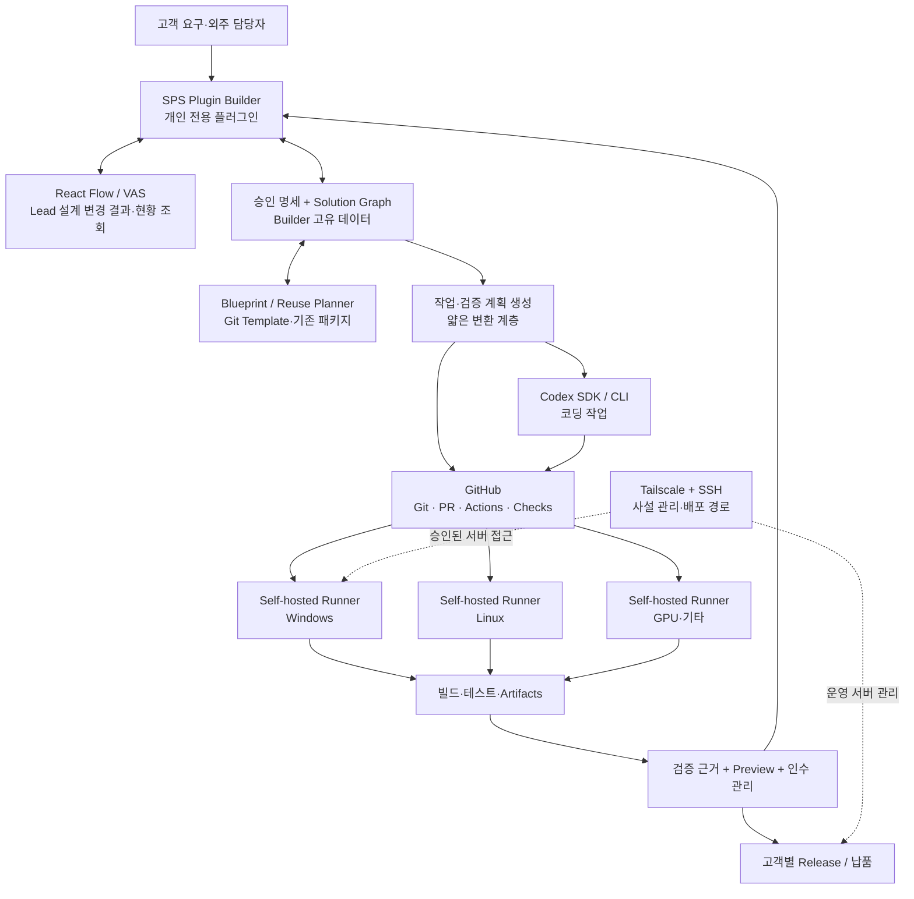
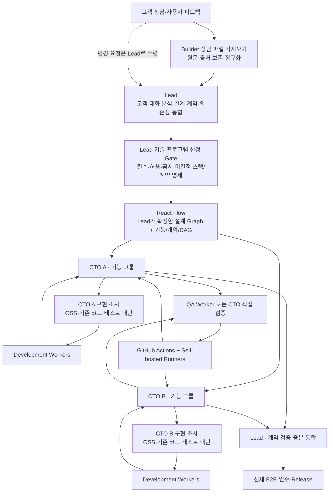
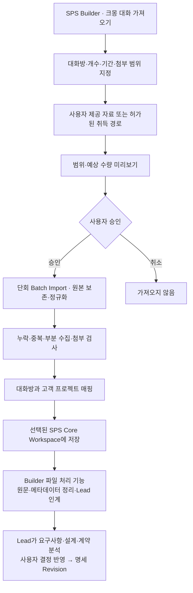
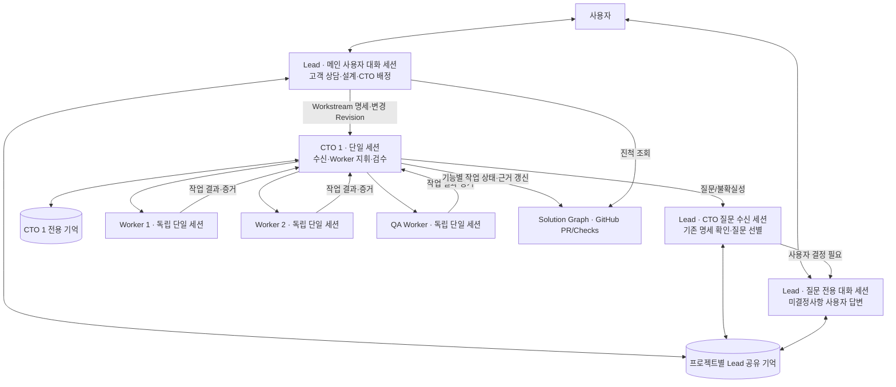

# SPS Plugin Builder (Solution Builder) — Codex 최종 통합 설계 및 인수인계

> **문서 ID:** SPS-PB-CODEX-FINAL-V15-2026-10-29  
> **개정:** v15 — 최종 검토의 Reuse 조사 구분·Lead 전용 Graph 편집·설계 답변 즉시 반영 관련 표현 3곳 및 팔레트 문구를 수정하고 2026-10-29 공식 문서 기반 기술 스택 선정 명세와 미검증/제외 항목을 추가. v14 — Document Worker를 현재 제품·AI 조직·Skills·UI·검수 범위에서 제거하고 향후 재검토 대상으로 이동. 고객 상담 파일은 기존 Builder 가져오기·정규화 기능으로 Lead에 직접 인계. QA Worker와 Lead/CTO/Worker 구성 및 v13 UI 정합성은 유지. v13 — UI v8과 Lead 설계 편집 정책 정합성 반영. v12 — Lead 3세션/CTO 단일 세션/Worker 독립 세션 및 작업 자율성 확정.
> **기준일:** 2026-10-29 (KST)  
> **대상:** SPS의 개인 전용 Plugin Builder 플러그인 및 외주 제작 기능  
> **설계 상태:** 완성형 목표 아키텍처. 실제 저장소의 구현 완료·테스트 통과·제품 호환성을 확인한 보고서가 아니다.  
> **최상위 원칙:** 이미 있는 기능은 재사용하고, Builder 고유의 기능만 최소한으로 구현한다.  
> **전달 대상:** Codex. 이 파일 하나만 읽어도 제품 목표·범위·제약·완료 기준을 이해하도록 작성했다.

---

## 0. Codex에게 전달하는 핵심 목표

기존 SPS Core·SDK·Preview·Plugin Builder/Lead/Worker·GitHub 연동 코드를 **우선 재사용**하여, **본인 전용 외주 제작 플러그인**을 완성한다. **SPS Core Workspace를 고객 프로젝트의 기본 작업 경계로 사용하며, Host에 한 번 설치된 Plugin Builder를 각 Workspace의 Primary로 활성화하는 구성을 우선한다.** 고객의 요구사항을 **React Flow 기반 시각적 설계도**로 구성하고, 검증된 Blueprint와 기존 프로그램을 먼저 검색·조합하며, 부족한 부분만 Codex 등 코딩 AI로 개발한다. GitHub Actions와 Self-hosted Runner를 사용해 빌드·테스트·패키징하고, 요구사항별 검증 증거와 승인 내역을 연결해 실제 납품 가능한 산출물을 만든다.

이 Builder는 SPS 전용 플러그인만 제작하는 도구로 제한하지 않는다. **SPS 플러그인 제작을 지원하면서**, 독립 앱·웹/API·Python 자동화·Agent·워크플로 및 복합 워크스테이션도 같은 외주 프로젝트에서 설계·제작·납품할 수 있어야 한다. Hermes Agent, OpenClaw, OCE, n8n, Codex 및 앞으로 등장하는 프로그램을 **기술 중립적인 선택지**로 취급한다.

**절대 금지:** 외부 제품에 이미 존재하는 Runner·Git·CI·코딩 AI·VPN·SSH 서버·작업 큐 등을 습관적으로 새로 개발하는 것, 검증하지 않은 API를 지원한다고 표시하는 것, 고객 승인·보안 검수를 AI 설명만으로 통과 처리하는 것, Core를 외주 도메인에 맞춰 범용성 없이 수정하는 것.

### 문서 적용 우선순위

1. **현행 실제 코드·SPS Core/SDK 공개 계약·고객 및 플랫폼 보안 제약**이 최우선. 불확실한 API는 검증할 때까지 미확정.
2. 이 문서는 기존 `SPS_Plugin_Builder_Codex_Handoff.md`, `SPS_Solution_Builder_Codex_Redesign_2026-10-26.md`, 가속화·VAS·Runner 설계 및 2026-10-28 통합본을 **반영한 최신 제품 목표**다. 직접 개발 범위가 충돌하면 이 문서의 **재사용 우선 / 자체 인프라 폐기** 결정을 적용한다.
3. 기존 구현의 동등·검증된 기능은 본 문서에 새 명칭이 있어도 중복 제작하지 않는다. 다음 표의 컴포넌트 명은 **논리적 책임**이며 새 패키지·서버를 강제로 뜻하지 않는다.
4. 사용자가 별도로 구현 착수를 지시하지 않은 상태에서는 설계서를 구현 완료나 변경 승인으로 간주하지 않는다.
5. **v14 현재 구성:** `상담 파일 가져오기(Builder 기능) → Lead → CTO → Development/QA Workers` 흐름, 사전 재사용 조사, Workspace별 메모리·상태 격리를 적용한다. **Document Worker AI 역할은 현재 범위에 없다.** Git Worktree는 이 문서의 **SPS Core Workspace**와 다른 개념이다.
6. **v3 추가 결정:** 크몽 상담 메시지는 **사용자가 선택한 범위만 단회 Batch Import**로 가져온다. 주기적 크롤러·웹훅·상시 자동 동기화는 범위에서 제외한다. 공식 내보내기/API 확인 전에는 비공식 대량 추출 가능하다고 가정하지 않는다.
7. **v4 추가 결정:** 상단 가로 헤더를 없앤 Lead 대화 중심 UI, 활성 AI 목록에서 Lead를 제외한 CTO/Worker 조회, 좌측 `시스템`(Host 공통 Runner 상태), 별도 `미결정사항` 질문 전용 Lead, CLI의 승인된 다중 인증 프로필 선택/전환을 아래 계약으로 설계한다. 현재 프로토타입은 데모 데이터이며 Codex/Runner가 실연동된 상태가 아니다.
8. **v5 결정:** 메인 Lead 대화 전용 HTML 뷰어를 별도 격리 창에 제공한다.
9. **v6 역할·수명주기 설계:** CTO는 프로젝트 업무를 맡는 지속적 정체성이다. **기존 v6의 상·하위 이중 세션안은 v12에서 폐기하고 단일 CTO 세션으로 대체한다.** CTO 전용 기억은 해당 CTO 범위에서만 관리한다. CTO 수는 프로젝트의 실제 필요에 따라 결정한다. Worker/QA는 CTO가 필요에 따라 하위 에이전트를 생성하되 실행 이력은 종료 후에도 보관한다. CTO의 통상 삭제 대신 **퇴직·보관**을 권장하며, 법적·계약상 삭제가 필요한 데이터의 관리자 폐기 예외를 둔다. 관련 UI 재설계는 이번 개정 범위가 아니다.
10. **v8 확정 결정 — 프로젝트별 CTO:** 하나의 프로젝트(SPS Core Workspace)에 **필요한 만큼 CTO를 독립적으로 생성·배정**한다. CTO 식별자, 단일 지시·Worker 지휘 CLI 세션, CTO별 메모리, 배정, Worker/QA·감사 기록은 **프로젝트 범위**이며, 다른 프로젝트의 동명 CTO와 같은 직원으로 묶지 않는다. 같은 Plugin Builder 설치본/CLI·Runner 기술을 공유할 수 있지만 프로젝트의 CTO 논리적 정체성은 공유하지 않는다. **Host 글로벌 CTO 명부·프로젝트 간 동일 직원 재배정은 현 단계 구현 범위에서 제외**한다.
11. **추후 검토 — 전문 분야별 지식 자산:** 프로젝트가 충분히 축적되면 재사용 가치가 검증된 분야별 참고 구현·Blueprint·의사결정·테스트 지식을 DB/검색 인덱스로 조직하는 방안을 검토한다. 현재는 **별도 글로벌 CTO 인사 DB나 분야별 학습/메모리 DB를 신규 구축하지 않는다.** 기존 Reuse Planner의 승인된 템플릿·링크 재사용과 구분하며, 고객 기밀·코드·대화의 자동 통합·학습을 금지한다.
12. **v10 확정 — 조사 역할 구분:** Lead는 고객 계약·설계 명세에 필요한 **사용·비사용 프로그램 및 기술 스택**을 조사·선정한다. CTO는 확정된 기술/계약의 범위에서 **구현 시간을 줄이기 위한 오픈소스 코드·라이브러리·참고 구현**을 조사한다. 두 단계의 조사 목적·권한·산출물은 혼동하지 않는다.

13. **v14 현재 구성 — 상담 입력·QA:** Builder의 기존 Import/Parser가 허용된 고객 대화 파일을 정규화해 Lead에 직접 인계한다. Lead가 계약 분석·요구사항 해석·설계 문서·Revision을 담당한다. **Document Worker는 생성·실행하지 않는다.** QA Worker는 CTO가 정의한 테스트 계획을 대신 실행·관찰·결과 보고한다. QA는 테스트 목표·인수 기준을 독자적으로 바꾸지 않으며, CTO는 QA 실행 중 다른 업무를 병렬 진행할 수 있다.
14. **v12 확정 — 세션·자율 운영:** Lead는 사용자 대화/CTO 질문 수신/미결정 질문 대화의 **3개 세션이 동일 프로젝트 Lead 기억을 공유**한다. CTO는 **단일 CLI 세션**에서 Lead의 지시 수신과 Worker·QA 지휘를 수행하며, 각 CTO의 기억은 서로 분리된다. Worker·QA는 **각자 단일 독립 세션**, 다른 Worker나 CTO의 기억을 자동 공유하지 않는다(명세·Task Packet·허용 데이터의 명시적 전달은 가능). Lead는 승인 없이 CTO를 생성하며, 고객 상담의 모호성은 메인 Lead에서 사용자와 논의한다. 사용자 답변은 추가 확인 없이 설계 Revision에 반영할 수 있다. CTO는 수정 명세 수신 시 진행 중인 Worker의 중단·계속·재작업을 자율 판단하되 최신 명세를 준수한다. CTO는 진행 현황을 Graph에 갱신하므로 정기 보고가 필요 없다.

**추후 검토:** 상담 파일 종류·규모가 증가해 기존 파일 가져오기/정규화 경로로 해결하기 어려워질 경우에만 Document Worker의 필요성을 재평가한다. 현 단계에서는 전용 세션·메모리·AI 역할·Skill·명령·UI 메뉴를 구현하지 않는다.

---

## 1. 제품 정체성과 외주 사업 범위

**SPS Plugin Builder = 외주 작업을 수행하는 본인 전용 SPS 플러그인.** 기능 범위는 `Solution Builder`로 확장하지만, 고객에게 판매하는 범용 Builder 제품이나 공개 마켓플레이스가 아니다. 납품물은 Builder 자체가 아니라 고객 요구에 맞는 프로그램·플러그인·작업환경이다.

| 분류 | 상품 가치 | 제품 예시 | Builder의 기술 선택과의 관계 |
| --- | --- | --- | --- |
| **S** | 반복 업무·소형 AI 자동화 | 문서 자동화, 개인 AI 비서, API 연동, 업무 Agent | SPS 사용 필수 아님 |
| **M** | **개인·1인 기업의 작업환경 — 대표 상품** | 1인 게임 개발, AI 개발, 1인 기업 운영, 콘텐츠, 연구 | 다중 도구 연계 가능 |
| **L** | 팀 협업과 공동 작업환경 | 팀 개발, 게임 개발팀, 업무·협업, AI Agent 협업 | 사용자·권한·공유 데이터 고려 |
| **XL** | 기업 수준의 통합·운영 환경 | 기업 업무, 기업 AI 운영, 산업별 특화 | 보안·감사·가용성·운영 계약 고려 |

- **S/M/L/XL은 사용자 가치·협업·운영 범위의 상품 분류**이지 사용 모델, 컴퓨터 수, 코드 복잡도, 정액 가격의 기준이 아니다.
- 기존 16개 세부 상품(S 4/M 5/L 4/XL 3), A01~A05 컨설팅·기능 추가·연동·이전·유지보수는 **카탈로그/템플릿 데이터**로 표현한다. 상품마다 개발 엔진을 각각 만들지 않는다.
- **M 개인 워크스페이스를 주력**으로 둔다. 그중 게임 개발(M01), AI 소프트웨어 개발(M02), 1인 기업 운영(M03)을 중요한 활용 사례로 지원한다.
- 고객에게 납품할 기술 Target은 `SPS Plugin`, `Standalone Desktop`, `Web/API`, `CLI/Python`, `Headless Agent/Workflow`, `Hybrid` 등으로 별도 선택한다.
- **개발용 Agent**(Builder가 코드를 작성하기 위해 호출)와 **납품용 Agent**(고객 솔루션 내부에서 작동)는 별개로 추적한다. 동일 프로그램을 양쪽에 활용할 수 있으나 권한·과금·출처를 섞지 않는다.

### 최종 사용자 경험

1. 고객 또는 외주 프로젝트마다 원칙적으로 **SPS Core Workspace 하나**를 사용하고, 그 Workspace에서 Plugin Builder를 Primary로 활성화한다.
2. **고객 상담 수집:** 크몽 등 외부 상담은 사용자가 대화방·메시지 수·기간을 선택하여 일회성으로 가져온다. 사용자 검토·프로젝트 매핑 후 기존 Builder 파일 처리 기능이 원문·첨부·출처를 정리해 Lead에게 직접 인계한다. **Lead가** 상담을 분석하고 요구사항·설계·계약·미결정 사항·인수 기준 초안을 작성한다.
3. **Lead Agent**가 고객 대화를 분석하여 설계·계약 명세를 작성하고 사용할/사용하지 않을 프로그램·스택을 결정한 뒤 전체 기능·계약·의존성을 React Flow에 시각화한다. 모호한 고객 요구는 **사용자 대화용 메인 Lead 세션**에서 확인한다.
4. Lead가 **의존성 엣지가 아니라 개발 가능한 기능 그룹(Workstream)** 을 CTO들에게 배정한다. CTO는 해당 그룹의 재사용 가능성을 더 조사하고 Workers에게 최소 구현 작업을 위임한다.
5. Development Worker가 코드를 개발하고, CTO 또는 독립된 QA Worker가 **GitHub Actions + Self-hosted Runner**로 검증한다. CTO는 담당 그룹을 지속 통합하고 Lead가 그룹 간 계약·전체 통합을 관리한다.
6. 사용자 피드백·미결정사항 답변은 Lead에 전달되어 **Lead가 별도 재확인 없이 설계 Revision에 즉시 반영 가능**하며, 영향 범위 확인·필요한 데이터 검증 후 관련 CTO에게 변경 명세를 전달한다. CTO가 실행 중 Worker의 중단·계속·재작업을 선택한다. 실제 대외 계약 체결·운영 배포 등 별도 권한 행위와 내부 설계 반영은 구별한다.
7. 코드, PR, Checks, 로그, 테스트, Preview와 요구사항을 한 화면에서 연결해 검수하고, 승인된 고객별 Release/납품·유지보수 기준점을 확정한다.

---

## 2. 완성형 전체 아키텍처



> 화살표는 **기능적 관계를 설명한 그림**이다. 모든 구성요소가 독립 서비스라는 뜻이 아니다. Codex는 Builder를 통한 로컬 실행 또는 GitHub Runner 내부 실행 중 검증된 경로를 사용하며, 동일 작업을 두 곳에서 중복 실행하지 않는다. Tailscale은 GitHub Actions의 Runner 배정에 필수 조건이 아니다.

### 다섯 가지 데이터·실행 개념을 혼동하지 않는다

| 개념 | 정식 의미 | 관리 원본 |
| --- | --- | --- |
| Product | 고객이 사는 S/M/L/XL 상품 | Builder 카탈로그 |
| Target | 실제 납품할 SPS Plugin·앱·Agent·워크플로 | Builder 승인 명세 |
| Capability / Tool | 구현이나 납품에 사용되는 프로그램의 검증된 기능 | 실제 제공자 문서·테스트 + 매니페스트 |
| Task / Run | 요구사항을 만족시키기 위한 실행·검증 작업 | Builder의 작업 의도 + GitHub 실행 기록 |
| Runner | Task를 처리하는 등록 컴퓨터 | **GitHub Actions Runner** |

---

## 2A. 계층형 AI 작업 프로세스 — 역할과 승인 흐름 (v2)

> 이 절은 UI 기능을 구현해야 한다는 지시가 아니라 **Builder의 완성형 작업 동작 규약**이다. 역할은 기존 Lead/Worker 및 Codex의 실제 지원 기능으로 구성하며, 각 역할마다 새로운 전용 서버·모델 인스턴스를 만들지 않는다. 작은 프로젝트는 한 Agent가 여러 역할을 겸할 수 있다.



### 2A.1 역할 책임

| 역할 | 책임 | 통제 범위 / 하지 않을 일 |
| --- | --- | --- |
| Lead | **3세션**(메인 사용자 대화/CTO 질문 수신/질문 전용 대화)·프로젝트별 Lead 공유 기억, 고객·계약 분석·설계 문서, 사용할/사용하지 않을 스택 선정, CTO 자동 생성·업무 배정·변경 전달·전체 통합 | CTO 작업을 일일이 보고받지 않고 설계 Graph·관련 Git/CI 근거로 파악; Worker 코드를 직접 지휘하지 않음 |
| CTO | **단일 CLI 세션**에서 Lead 작업 명세 수신, 코드 재사용 조사, Worker/QA 세션 생성·지휘·검수, 담당 Graph 기능·검증 상태 갱신, 개정 명세 적용 전략 자율 결정 | CTO 간 기억 공유 없음; 다른 CTO 계약·Lead 기술 결정을 임의 변경하지 않음. 정기 진행 보고 의무 없음 |
| Development Worker | **작업별 단일 독립 세션**, CTO Task Packet·명시적으로 받은 자료에 따라 구현·단위 테스트·PR·결과 기록 | 다른 Worker의 기억 자동 공유 없음; 승인 범위·API 계약 밖 무단 수정 금지 |
| QA Worker | CTO가 작성·배정한 테스트 계획에 따른 Runner 테스트 실행·관찰·로그 수집·결과 보고 | 독자적 테스트 계획·합격 기준 변경이나 최종 검수 확정 금지; 누락/오류 발견 시 CTO에 제안 |
| GitHub Actions / Runner | `needs`·라벨/그룹에 따라 실행·빌드·테스트·로그·아티팩트 관리 | 설계 결정·고객 승인·동적 AI 계획을 대신하지 않음 |

**'의존성'과 '작업 그룹' 구분:** Lead가 CTO에게 맡기는 것은 `기능 그룹/Workstream`이다. `depends_on` 등 의존성은 그룹 간 선후조건 및 통합 계약을 나타낸다. 먼저 공용 인터페이스·데이터 계약과 테스트 경계를 확정하면 일부 의존 관계가 있어도 Mock/계약 기반 병렬 개발이 가능하다.

### 2A.2 Reuse-First Gate의 두 목적 — Lead의 설계 결정 / CTO의 구현 가속 (v10 확정)

**두 조사는 같은 작업을 중복 수행하는 절차가 아니다.** Lead는 **고객과의 설계·계약 합의를 위해 어떤 프로그램·스택을 사용하고 사용하지 않을지**를 조사한다. CTO는 **Lead가 정한 설계를 준수하면서 담당 개발을 가장 빨리 완료하기 위해 참고·재사용 가능한 코드를** 조사한다.

**A. Lead: 설계·계약용 기술 조사 — CTO Workstream 배정 이전**

1. 고객의 요구사항, 예산·운영비, 배포 환경, 호환성, 보안·라이선스, 유지보수 및 사용 금지 조건을 확인한다.
2. 기존 SPS/고객 승인 자산, 완성 프로그램, 공식 서비스·API, 주요 프레임워크/스택을 조사하여 **프로젝트 아키텍처에 포함할 기술과 제외할 기술**을 결정한다. CTO가 사용할 개별 코드 예제를 깊게 수집하는 업무와 구분한다.
3. 승인 가능한 **Technology Decision Register(기술 선정 명세)**를 설계/계약 문서에 연결한다. 기술별 `required(필수)`, `allowed(CTO 재량)`, `prohibited(금지)`, `undecided(미결정)`를 명확히 분리한다. *문서에 단순히 언급되지 않은 기술을 자동으로 금지한 것으로 간주하지 않는다.*
4. 각 결정에는 선택·비선택 이유, 적용 범위, 상호운용 계약, 고객·플랫폼 제한, 비용 및 필요시 버전·호환 기준, 변경 승인 책임자를 남긴다. 확정되지 않은 계약 조건은 고객이 승인한 것처럼 표현하지 않는다.
5. 설계 Graph와 Workstream 명세가 **승인된 기술 선정 문서의 식별자/Revision**을 참조하도록 하고, 이 기준에 맞춰 CTO 담당 범위를 배정한다.

**B. CTO: 개발 속도 개선용 구현 조사 — 담당 Workstream 수신 후, Worker 배정 이전**

1. 담당 Workstream의 목표, 수용 기준, **Lead의 필수·허용·금지 스택**, 공개 API/데이터 계약을 먼저 읽는다.
2. 해당 스택 안에서 기존 코드, 재사용 가능한 패키지·컴포넌트, 라이선스가 적합한 오픈소스 코드, 유사 프로젝트의 참고 구현, 테스트 패턴을 찾는다. 조사 자체로 지연시키지 않도록 필요 시 조사 Worker를 짧게 투입한다.
3. 후보별 실사용 가능성, 라이선스, 보안, 호환성, 적용/수정/테스트 시간과 직접 구현 대비 절감 효과를 비교한다. 단순 참고와 코드를 복제·포함하는 행위를 구분한다.
4. CTO가 재량으로 선정할 수 있는 세부 라이브러리는 **Lead가 승인한 기술 범위 안에서** 선택하고 결과를 기록한다. Lead의 `required`/`prohibited` 기술 또는 다른 CTO와의 인터페이스 계약을 임의 변경하지 않는다.
5. Worker에게는 최종 구현 범위, 조사한 코드·문서 링크 및 확인 상태, 활용·수정 가능한 부분, 중복 개발하지 않을 부분, 완료/검증 기준을 포함한 Task Packet을 전달한다. **목적은 조사 보고서 생산이 아니라 Worker 작업량 감소**다.
6. 적합한 후보가 없거나 조사 비용이 예상 절감보다 커지면 조사를 중단하고 승인된 스택으로 직접 구현한다. 작업 도중 기존 설계에 부적합성이 확인되면 CTO가 Lead에 **스택·명세 변경안**을 제출한다. Lead의 결정과 필요한 사용자 승인 없이 강행하지 않는다.

**산출물 구분:** Lead → `기술 선정 명세 + 설계/계약 Revision + CTO Scope`. CTO → `재사용·참고 코드 조사 결과 + Worker Task Packet + 검증 근거`. 양쪽 결과는 프로젝트 Workspace에 저장하고, 고객 자료·코드의 타 프로젝트 유출과 무권한 재사용을 금지한다.

### 2A.3 구현·통합·피드백 절차

- CTO 내부: Development Worker의 변경 → 단위/계약 테스트 → PR 검토 → CTO 기능 그룹 통합. CTO는 검증 근거와 연결된 **실제 작업 상태를 설계 Graph에 갱신**하며 Lead에게 정기 보고를 보내지 않는다.
- Lead 전체: 그룹 간 공개 계약 테스트 → 준비된 결과물의 **증분 통합** → 회귀/E2E → 인수. *모든 CTO가 끝날 때까지 모아두었다가 한 번에 병합하지 않는다.*
- **CTO가 테스트 목표·대상·환경·절차·기대 결과·합격 기준을 설계**한다. QA Worker는 해당 Test Plan을 받아 승인된 GitHub Actions/Runner에서 실행하고 로그·증거·실패·재현 조건을 보고한다. 스크립트/워크플로에 결함이 발견되면 CTO에 수정안을 제출할 수 있으나 스스로 테스트 범위·합격 기준을 완화하거나 확정하지 않는다. CTO는 QA 실행 중 다른 작업을 병렬 진행할 수 있고, 권한이 있으면 테스트를 직접 실행할 수도 있다.
- Runner는 실행 호스트이고 QA 판단 주체가 아니다. SSH/Tailscale은 별도 승인된 원격 관리·배포에 한정하며 QA 권한과 운영 SSH 권한은 자동 연계하지 않는다.
- 사용자 피드백은 Lead에 수렴 → **Lead가** 상담 근거·변경 요구를 해석하고 영향 분석 및 Graph Patch/명세 개정안을 작성 → **사용자 답변은 별도 재승인 없이 새 설계 Revision에 반영** → 영향받는 CTO에 개정 명세 전달. CTO가 기존 Worker/QA Run의 중단·유지·재작업을 판단하고 필요 테스트를 재실행한다. 계약 체결·대외 발송·운영환경 배포 등 별도 행위는 독립된 권한을 요구한다.
- Worker/CTO/Lead는 각자 승인된 범위의 기록을 참조하되, **동일 Workspace의 공유 상태를 수정할 때는 Revision/Task ID를 사용**하여 동시 갱신을 추적한다.


### 2A.4 상담 파일 입력(비-AI)·QA Worker 최소 책임 계약 (v14 확정)

- **상담 파일 입력 = Builder 기존 기능**. 허가된 내보내기 결과와 TXT/HTML/CSV/JSON/첨부 파일을 기존 Import/Parser로 처리하고 원본·순서·발신자·시간·출처를 보존한 정규화 입력을 Lead에게 직접 전달한다. **Document Worker AI를 생성하지 않는다.** 고객 요구사항·계약·설계·수정 승인·인수 기준의 의미 판단은 Lead가 한다.
- **QA Worker = CTO 테스트 대행 Worker**. CTO가 `TestPlan`으로 테스트 대상, 대상 소스/커밋, 실행 환경·Runner 제약, 테스트 명령/절차, 기대 결과·합격 기준, 증거 항목을 지정한다. QA는 해당 계획을 실행·모니터링하고 `QAResult`에 결과·실행 Run/Check/로그·재현 조건·환경 정보를 연결해 CTO에게 돌려준다. 테스트 설계·완료 판정·전체 검수 책임은 CTO/Lead에게 남는다.
- **병렬 실행**: CTO는 QA Run을 시작한 뒤 독립적인 설계·코드 리뷰·다른 Worker 관리 업무를 진행할 수 있다. QA가 실행 중이라는 이유로 CTO 세션 전체를 기다리게 하지 않는다. **QA 시험의 판정은 테스트 시점의 코드/커밋·명세 Revision에만 유효**하며 CTO가 이후 새 커밋을 통합하면 관련 회귀/재시험 필요성을 CTO가 판단한다.
- **변경 통제**: QA는 기존 테스트의 실패를 숨기거나 테스트를 제거·완화해 합격시킬 수 없다. 테스트 스크립트 문제·누락은 `TestPlan` 개선 제안으로 CTO에 보고한다. QA에 자체적인 코딩·계약 변경 권한을 자동 부여하지 않는다.
- **실행·기록**: 상담 인계는 AI 세션 없이 Import 이벤트·출처·검증 이력으로 기록한다. QA Worker만 필요할 때 생성되며 TestPlan/Run/로그를 프로젝트 Workspace의 Task·이력에 연결한다. 전용 장기 메모리·상주 모델·전용 서비스는 필요하지 않다.

---

## 2B. 프로젝트별 SPS Core Workspace 및 메모리·상태 격리 (v2)

### 2B.1 결정: SPS Core Workspace를 프로젝트의 기본 관리 경계로 사용

> 여기서 `Workspace`는 **SPS Core가 제공하는 Workspace**를 뜻한다. 로컬 폴더, Git worktree, IDE workspace, Runner 작업 디렉터리와 동일하지 않다.

- **기본 매핑: 고객 프로젝트 1개 ↔ SPS Core Workspace 1개.** 복수 저장소/기능 그룹/CTO는 한 Workspace 내부에서 프로젝트별 하위 개념으로 관리한다. 고객의 여러 프로젝트는 원칙적으로 서로 다른 Workspace로 나눈다. 프로젝트·고객 모델 자체는 Builder 플러그인이 소유한다.
- **Plugin Builder 패키지는 Host에 1회 설치**하고, 각 프로젝트 Workspace에서 동일 Builder를 **그 Workspace의 Primary 플러그인**으로 활성화한다. 각 Workspace의 Primary는 최대 1개이며 Primary 없는 Workspace도 허용한다. 기존 Primary와 충돌하면 자동 교체하지 않고 사용자의 선택/승인이 필요하다.
- 각 Workspace의 활성화·설정·저장 데이터·승인 명세·Solution Graph·Agent 대화·메모리·작업 기록·사용권 범위는 독립적이다. Builder를 프로젝트마다 다시 설치하거나 SPS Core를 여러 번 실행하지 않는다.
- 여러 Workspace를 동시에 열거나 백그라운드에서 실행하는 목표는 유지한다. **Workspace 전환/창 닫기가 다른 Workspace의 승인된 작업을 종료하지 않도록** Core 계약에 맞춘다.
- SPS Core의 Workspace 실행·저장 격리 정책은 실제 구현 확인 대상이다. 문서상의 분리는 보안 검증이 끝난 사실을 뜻하지 않는다.

```text
SPS Host / Core (공유, 한 번 실행)
  ├─ Plugin Builder 설치 패키지 1개 (Host-scoped)
  ├─ Workspace A (고객/프로젝트 A) ─ Primary = Plugin Builder
  │    ├─ Lead · CTO A/B · Dev/QA Worker (상담 파일은 Builder Import)
  │    ├─ A 전용 메모리/대화/설계 Revision/Graph/작업상태
  │    └─ A 승인 범위의 GitHub 저장소·Workflow·Runner 실행 참조
  ├─ Workspace B (고객/프로젝트 B) ─ Primary = Plugin Builder
  │    └─ B 전용 메모리/대화/설계 Revision/Graph/작업상태
  └─ Workspace C (다른 업무) ─ 다른 Primary 또는 없음
```

### 2B.2 메모리와 데이터의 원칙: 섞이지 않아야 한다

- AI 대화·요약·장기 기억·검색 인덱스·벡터 저장·도구 결과·파일 참조·승인 이력은 최소한 `(hostId, workspaceId, pluginId, projectId)`와 역할/세션·작업 범위를 추적한다. 실제 Core/SDK 계약에 적합한 키·스코프를 사용한다.
- **읽기 단계에서부터 Workspace·고객 접근 권한을 집행**한다. 단순히 프롬프트에 `다른 프로젝트를 참조하지 마`라고 적거나 파일 경로 접두사만 구분하는 것은 격리 근거가 아니다.
- **메모리 공유 경계:** 같은 프로젝트의 **Lead 3세션만 Lead 공통 기억**을 공유한다. CTO 기억은 `(workspaceId, projectId, ctoId)`별로 분리하고, Worker·QA의 독립 세션 기억은 다른 Worker/CTO/Lead에게 자동 공유하지 않는다. 대신 현재 Workspace에서 허가된 **승인 명세·Graph·Task Packet·도구 결과의 명시적 전달·조회**는 가능하다. 다른 Workspace의 기억·상담·소스·비밀은 자동 합쳐지지 않는다.
- 같은 호스트의 한 프로세스/Worker에 여러 Workspace의 작업이 들어오더라도 내부 메모리 캐시·에이전트 세션·검색·툴 결과를 Workspace 간 분리한다. 공유 프로세스는 **OS 보안 격리와 동등하지 않음**을 표시한다.
- 공용 Reuse Knowledge Base는 개별 고객 원본을 자동 수집하지 않는다. 출처·재사용 권리·기밀 제거·명시적 공유 범위가 충족된 자산만 별도 공용 영역에 수동/승인된 정책으로 반영한다.
- Workspace 종료·일시정지·데이터 초기화·백업/복원은 Core 계약을 따르며 다른 Workspace에 영향을 주지 않아야 한다. 외부 GitHub/Runner 작업은 실제 제어·취소 가능성을 확인한 후 상태를 조정한다.
- GitHub Repository/PR/Artifacts, Tailscale/SSH 계정, 로컬 프로젝트 폴더, 환경변수/Secrets는 Workspace ID와 연결하지만, 단순 Workspace 분리만으로 외부 서비스 권한까지 분리되는 것은 아니다. **별도의 최소 권한 정책**이 필요하다.

### 2B.3 자원 비용 및 실제 적용 기준

| 구성 | Workspace마다 중복하는가? | 설계 원칙 |
| --- | --- | --- |
| SPS Core Host | 아니오 | 하나의 Host 서비스 공유 |
| Plugin Builder 설치 패키지 | 아니오 | Host-scoped 설치 1회, Workspace별 활성화 |
| Builder 설계·메모리·세션 데이터 | 예 (독립 데이터) | 필요한 데이터만 프로젝트별 저장 |
| AI Agent 모델·외부 API | 필수 아님 | 동일 모델 공급자/실행기 공유 가능, **컨텍스트·인증·조회 범위는 분리** |
| Plugin Worker 프로세스 | **실제 Core 실행모델 확인** | 현재 문서상 Host 공유 Worker 경로가 있어 Workspace당 새 프로세스를 가정하지 않음 |
| 열려 있는 프로젝트 UI·상태 구독 | 예, 상황에 따라 | 사용하지 않는 View 구독·렌더를 줄임 |
| Git Worktree·의존성·빌드 캐시 | 필요할 때만 | 동시 파일 수정 시 Worktree 사용; Workspace마다 복제하지 않음 |
| GitHub Runner 컴퓨터 | 아니오 | 기존 Runner 공유, 고객 위험 수준에 따라 전용 그룹/격리 |
| GPU에 올린 로컬 AI 모델 | 필수 아님 | 공유하는 경우 고객별 세션·메모리·프롬프트/캐시 분리 검증 |

**자원 결론:** SPS Workspace를 프로젝트마다 나누는 것은 `코어·플러그인 패키지를 프로젝트 수만큼 복제하는 구조`가 아니므로 일반적으로 합리적인 기본값이다. 다만 프로젝트별 활성 세션·메모리·저장 데이터·UI·작업이 증가하는 만큼 RAM/CPU/디스크 사용량이 **0인 것은 아니다**. 실제 Core의 공유 Worker 방식과 백그라운드 실행을 기준으로 메모리·CPU·스토리지 증분을 측정하여 확인한다. Workspace를 단순히 나누기 위해 VM/컨테이너/별도 Runner를 만들지 않는다.

### 2B.4 SPS Core Workspace와 Git Worktree의 관계

- **SPS Workspace:** 플러그인의 기본 화면, 메모리·고객 프로젝트, 작업 승인·권한·실행 상태를 관리하는 상위 단위.
- **Git Repository:** 프로젝트의 소스 진실 원본. Workspace 내 하나 또는 여러 저장소를 연결할 수 있다.
- **Git Worktree:** 여러 CTO/Worker가 **같은 저장소의 서로 다른 브랜치**를 동시에 수정할 때만 별도로 만드는 개발 작업 디렉터리.
- **Runner 작업 폴더:** GitHub Actions에서 실제 CI Job을 수행하는 격리된 실행 위치. 프로젝트 Workspace와 1:1로 매핑되지 않으며, 접근은 자격증명·정책으로 제한한다.

### 2B.5 구현·검증상의 주의

현행 Core 설계 문서 `SPS_Core_Plugin_Architecture_Handoff_2026-10-25.md`는 Host당 최대 하나의 공유 Plugin Worker 모델, Workspace별 실행·데이터 분리, Primary 최대 1개, 여러 Workspace 동시 동작을 **목표 아키텍처**로 제시한다. **같은 Builder 패키지가 서로 다른 Workspace에서 동시에 활성화되는 실제 동작, 메모리/세션 분리, Workspace별 중지·복구, 비밀 원문·파일 접근 경계는 현행 저장소 코드와 테스트로 검증해야 한다.** 격리가 검증되지 않으면 고객 기밀을 안전하게 처리할 수 있다고 표시하지 않는다.

---

## 2C. 크몽 상담 대화 — 사용자 지정 범위 일회성 Batch Import (v3)

> **정식 결정:** 크몽에서 실시간 동기화·계속 감시·스케줄 수집하는 시스템은 만들지 않는다. 사용자가 **수동으로 실행하는 1회 Batch Import**를 기본으로 한다. 한 번의 사용자 요청이 내부적으로 여러 페이지·파일에 나뉘어 처리될 수는 있으나, 다음 실행은 **새 사용자 명령이 있을 때만** 시작한다.

### 2C.1 사용자 선택 범위와 동작

| 선택 항목 | 기능 계약 | 주의 사항 |
| --- | --- | --- |
| 대화방 대상 | `전체 / 사용자 선택 / 최근 N개` | 보유 대화 수는 실제로 확인 가능한 범위만 표시; 선택 전 무단 수집 금지 |
| 메시지 깊이 | `선택한 대화방 전체 / 각 대화방 최근 N개` | `최근 N개`는 각 대화방의 메시지 수를 뜻하며 대화방 수 N과 구분 |
| 기간 | `전체 기간 / 시작일~종료일` | 시간대·정렬·경계 포함 규칙 명시. 정확한 시각 미제공 시 추정 표시 |
| 첨부파일 | `미포함(기본) / 포함(별도 승인)` | 실제 다운로드 허용·가능 범위만. 접근 불가 첨부는 누락으로 표시 |
| 저장 대상 | `기존 프로젝트 Workspace / 신규 프로젝트 후보로 분류` | 고객 대화방과 프로젝트가 1:1이라고 가정하지 않음 |
| 실행 | `미리보기 → 범위 확인 → 가져오기 1회` | 수집 범위·민감정보·저장 위치 승인 기록 |

- **예시 A:** 최근 대화방 20개 × 각 대화방 최근 메시지 100개. 실제 가져올 메시지가 2,000개보다 적을 수 있고, 2,000개 수집을 보장하는 것은 아니다.
- **예시 B:** 특정 고객 대화방 1개 전체 이력(접근 가능 범위에 한정).
- **예시 C:** 사용자가 선택한 5개 대화방의 특정 기간만 수집.
- **중복된 지정 조건:** 대화방/기간/메시지 수 제한은 **교집합**으로 적용하고, 사전 미리보기에서 예상 범위를 설명한다. `전체`는 승인된 소스에서 접근 가능한 전체를 의미하며 삭제된 메시지/비노출 과거 데이터까지 보장하지 않는다.
- 사용자가 다시 가져오기를 명령할 수는 있으나 이는 **새로운 수동 Batch**이며, 예약·폴링·자동 업데이트와 다르다.

### 2C.2 소스 취득 경로 — 지원 여부를 사실로 확인

**우선순위:** (1) 크몽이 공식 지원하는 허가된 내보내기/API가 실제로 확인되면 해당 기능 활용 → (2) 사용자가 직접 제공한 TXT/HTML/CSV/JSON/문서/복사한 대화 내용을 파일 입력으로 가져오기 → (3) 별도 허가 및 현행 이용약관 검토를 통과한 범위에 한해서만 브라우저 보조 기능 검토.

- 2026-10-28 현재 확인한 크몽 고객센터 안내는 **PC 대화방 목록 검색·개별 메시지 복사·첨부**를 설명하나, **계정 대화 전체 일괄 내보내기 API/Export**는 확인하지 못했다. `공식 Batch API가 존재함`, `Playwright로 모든 과거 메시지를 추출 가능함`이라고 사실처럼 적지 않는다.
- 크몽의 서비스 약관(2025-09-18판 확인 필요)과 승인 범위를 준수한다. **허가되지 않은 자동 스크래핑, 로그인 우회, CAPTCHA/봇 방어 우회, 비공식 인증 토큰·세션 쿠키 추출**을 구현 목표로 삼지 않는다. 자동 수집 허가 여부가 불분명하면 **수동 제공 파일·복사 입력**을 우선한다.
- 사용자가 계정을 정상 로그인한 상태라고 해서 대량 수집의 이용약관·제3자 개인정보 처리 제한이 자동 해제되지는 않는다.
- 자체 크롤링 서버, 주기 동기화 데몬, 자체 크몽 API 역공학을 기본 설계에 넣지 않는다. 기존 파일 파서·브라우저 기능·문서 import 코드가 있으면 재사용한다.

### 2C.3 내부 처리 파이프라인



- **원본 자료**와 **정규화된 메시지**를 구분해 보존하고, 발신자 역할/표시명, 원문, 순서, 가능한 타임스탬프, 대화방 식별자, 첨부 참조, 원본 출처·가져오기 ID를 유지한다. 원본과 파생 문서는 원본 메시지 해시·소스 참조로 추적 가능해야 한다.
- 메시지 수가 많으면 내부적으로 청크 처리해 UI가 멈추지 않도록 하되, **새 백그라운드 상시 서비스나 크롤러 인프라를 별도 개발하지 않는다**. 사용자 취소/재실행 시 현재까지의 처리 상태를 명확히 보존한다.
- 재실행 시 메시지 ID 또는 신뢰 가능한 출처 식별자를 우선 사용해 중복을 막는다. 고유 ID가 없으면 해시·발신자·시간·대화방을 조합하되 충돌 가능성을 기록한다. 모호한 중복은 원본을 조용히 삭제하지 않고 검토 대상으로 남긴다.
- 불완전한 이력, 시간 누락, 첨부 접근 실패, 페이지 처리 실패는 `PARTIAL / INCOMPLETE / FAILED`와 수집 근거로 표시한다. **Builder 가져오기 기능이나 Lead는 존재하지 않는 상담 기록을 추정해 채우지 않는다**.
- 고객별 프로젝트 Workspace가 지정되기 전의 가져오기 자료는 범위가 제한된 **임시 수집·검토 영역**에 보관한다. 모든 Workspace의 AI가 조회하는 공용 메모리나 공용 Blueprint에 자동 투입하지 않는다. 프로젝트 확정 후에는 승인된 Workspace에만 보관·검색한다.
- 고객 연락처, 결제/거래 정보, 민감한 파일 등은 최소 수집·마스킹·저장기간·삭제 정책을 따른다. Lead에게 전달할 입력은 프로젝트 범위만으로 축소하며, 외부 AI 전송은 고객과 플랫폼의 데이터 처리 조건을 확인한 경우에만 허용한다.

### 2C.4 최소 기능과 비목표

**Builder가 직접 개발할 최소 기능:** 가져오기 범위 선택 UI, 제공받은 파일·텍스트의 정규화, 중복·누락 표시, Workspace 매핑, Lead 직접 인계, 관련 테스트. 단순 파일 파싱·전달은 AI 호출 없이 기존 기능/스크립트를 우선한다.

**기본 개발에서 제외:** 크몽 메시지 자동 감시, 신규 메시지 정기 수집, 크몽 로그인/인증 우회, 커스텀 대규모 크롤링 인프라, 검증되지 않은 공식 API 에뮬레이션, 제3자 고객 연락처 무단 수집, 다른 Workspace 간 상담 원문 공유.

**기능 제공 상태 분리:** `설계됨`과 `실제로 자동 추출 가능`은 다르다. 크몽 공식 Export/허가된 자동 수집 경로를 검증하지 못했다면 UI에서는 **수동 자료 가져오기 지원**으로 명시하고 원클릭 전체 수집을 이미 지원하는 것처럼 표시하지 않는다.

### 2C.5 데이터 계약 예시 (실제 SPS SDK 선언 아님)

```ts
type ConversationBatchImport = {
  importId: string;
  source: 'kmong' | 'manual-file';
  sourceAcquisition: 'official-export' | 'user-provided-file' | 'user-copied-text' | 'approved-browser-assisted';
  scope: {
    threads: 'all-accessible' | 'selected' | 'recent-n';
    threadLimit?: number;
    threadRefs?: string[];
    messagesPerThread: 'all-accessible' | 'recent-n';
    perThreadMessageLimit?: number;
    from?: string;
    through?: string;
    includeAttachments: boolean;
  };
  destinationWorkspaceId?: string; // 검토·승인 후 매핑 가능
  status: 'draft' | 'previewed' | 'approved' | 'running' | 'partial' | 'completed' | 'failed' | 'cancelled';
  approvalRef?: string;
  sourceEvidenceRefs: string[];
};
```

> 이 계약은 **수집 대상 범위**의 표현일 뿐, 크몽의 숨겨진 API나 미검증 메시지 ID·시간 필드가 실제로 제공된다는 뜻이 아니다.

---

## 2D. Builder 사용자 인터페이스 — 대화·조회·설계·미결정사항·시스템 (v4)

> `SPS_Builder_Lead_UI_Aligned_v9_No_Document_Worker.html`은 이 UI의 **최신 인터랙션 프로토타입**이다. UX 스펙을 검토하기 위한 단일 HTML이며, 상태가 실제 GitHub·Codex·SPS Core에서 조회된 것이라는 뜻이 아니다. 임의로 다른 탭/메뉴를 부활시키거나 기존 시각화/에이전트 기록 기능을 삭제하지 않는다.

1. **메인:** 중앙 Lead 대화가 기본 화면이다. 본문 위의 `SPS Builder / Workspace / Spec` 등 별도 수평 상단 바를 두지 않아 세로 작업 영역을 넓힌다. **좌측 상단 Builder 로고와 SPS Core Workspace 선택기는 유지**한다.
2. **좌측 주 메뉴:** `Lead 대화`, `설계 시각화`, `조직도`, `설계 문서`, `미결정사항`, **`시스템`**. 기존 `체크포인트`, `AI들`, `수정사항`을 독립 탐색 메뉴로 두지 않는다. 오른쪽 작업 기록은 메인/에이전트 조회 화면의 패널로 유지한다.
3. **좌측 활성 AI:** 현재 선택한 Workspace에서 활동 중인 `CTO 1, CTO 2, Worker 1, QA …`의 실제 세션만 표시한다. **Lead는 활성 목록에서 제외**하되 메인 Lead 대화·조직도에서의 Lead 역할은 유지한다. 비활성·대기 세션은 현재 활성 목록에 포함하지 않는다. 아이콘 클릭 시 해당 세션으로 이동한다.
4. **하위 AI 읽기 전용:** CTO·Worker·QA 화면 **중앙에는 해당 CLI 세션의 실제 대화 이력/지시·보고 흐름**, 오른쪽에는 그 AI의 수정사항·작업 지시·활동 기록·관련 파일을 표시한다. 사용자 메시지 전송은 막는다. 내용과 순서의 출처/실행 시각/세션 ID는 실제 연동에서 검증 가능해야 한다.
5. **미결정사항:** CTO는 단일 세션에서 모호성을 **CTO 질문 수신 전용 Lead 세션**에 전달 → 그 Lead 세션이 기존 명세로 해결 가능한지 판단하고 사용자 결정이 필요할 때 질문 생성 → 오른쪽 미결정 목록 → 중앙은 **질문 전용 Lead 세션**에서 사용자와 대화. **사용자가 답하면 추가 승인 질문 없이 Lead 공유 기억·설계 Revision에 반영**하고 필요한 CTO 명세 개정을 전파한다. 고객 상담에서 드러난 설계 모호성은 별도 미결정 큐를 거치지 않고 **메인 Lead 대화**에서 처리한다.
6. **설계 시각화:** **Lead만 설계 구조·기술 선택·의존성·CTO 담당 Scope를 편집하며 사용자는 조회 및 Lead에게 자연어로 수정 요청만 할 수 있다. 사용자용 수동 노드 편집 UI는 필수 기능이 아니다.** 기능/의존성 기반 그래프를 유지하되 CTO별 담당 범위를 '영역 지도'처럼 구분하고, 현재 수행 중인 기능 위에 CTO 아이콘·작업명을 표시한다. CTO 아이콘 클릭 시 해당 CTO의 **세션 대화 기록은 보이되 사용자 입력은 불가능한 조회 전용 화면**으로 연결한다. 설계 노드/작업 실행/QA 결과의 데이터 원본은 분리한다.
7. **시스템:** **현재 Workspace에 종속되지 않는 Host 공통 화면**이다. GitHub Self-hosted Runner에 등록된 컴퓨터, 온라인/오프라인, 작업 중(`busy`), OS, 라벨, Runner/그룹 식별, 최근 작업 및 최종 조회 시각을 보여준다. `status=online`과 `busy=true`를 구분하며, API 조회 실패/권한 부재/오래된 데이터는 별도 상태로 표현한다. 이는 실제 컴퓨터의 CPU/GPU 사용률을 자동으로 제공한다는 주장이 아니다. 필요시 호스트/노드 텔레메트리를 검증된 별도 소스로 연동한다.
8. **Core 설정:** 좌측 하단 사용자 프로필에서 **SPS Core SDK가 실제 제공하는 Core 설정 진입 기능**을 호출한다. Builder가 Core 설정 관리자 화면을 자체 모방하거나 임의로 권한을 취득하지 않는다.
9. **모바일/iPad:** 상단 바 제거 후에도 오른쪽 기록/질문 목록을 닫힌 드로어에서 열 수 있도록 **각 화면 제목 영역에 열기 버튼**을 둔다. 링크/해시 기반 화면 전환과 터치 선택을 유지한다.

**UI–데이터 연결 및 책임:** (1) 설계 그래프와 CTO 담당 Scope는 **SPS Core Workspace별** 데이터를 읽고, CTO 생성·Worker 상태에 따라 실시간 재구성한다. (2) 기존 Builder 파일 가져오기 기능이 대화를 **Lead에게 직접 인계**하며, **설계 문서의 작성·관리 주체는 Lead**다. (3) `QA Worker`는 **CTO의 TestPlan을 실행·결과 회신**한다. (4) CTO 미결정 질문은 오른쪽 목록에서 선택지·장단점·Lead 추천·자유 입력으로 다루고, 사용자 결정이 확정되면 별도 승인 없이 **Lead의 Revision/관련 CTO 지시**로 연결한다. (5) HTML 시제품의 상태·그래프·Revision 변경은 **데모 메모리만** 수정하고 실제 SPS/GitHub 기록을 바꾸지 않는다.

**UI 운영 규칙:** 완료율 퍼센트나 별도 체크포인트 화면을 강제하지 않는다. 실제 작업 진행은 설계도의 CTO 구역/진행 기능과 각 AI 실행 기록에서 확인한다. 진행률을 근거 없이 추정하거나 데모를 실제 작업으로 표시하지 않는다.

---

## 2E. 공용 CLI 계정 프로필 풀·실행 자격 분리 (v4)

### 2E.1 목표와 지원 가능성

- 운영자는 본인이 사용 권한을 가진 **같은 CLI 공급자의 복수 인증 프로필**을 등록하고, Builder의 Lead/CTO/Worker/QA 실행이 필요에 따라 그 프로필 풀에서 **적격한 실행 프로필을 선택하거나 전환**할 수 있기를 원한다. 이는 기술적으로 설계 가능한 실행 모델로 포함한다. 단, **프로필을 여러 개 가질 수 있다는 사실이 공급자의 사용량 한도 우회 허가를 뜻하지는 않는다.** 자동 선택/전환의 실제 활성 범위는 공급자의 현재 약관·계약 및 관리자 정책을 따른다.
- Codex CLI는 환경 변수 `CODEX_HOME`으로 설정·상태 위치를 결정하며, 파일 인증 방식을 택하면 해당 폴더 아래 `auth.json`을 저장한다. `keyring/auto/ephemeral` 등의 인증 저장 방식도 실제 버전 지원 범위에 따라 사용할 수 있다. 따라서 **프로필마다 독립 CODEX_HOME/자격 증명 저장소를 두고 작업 프로세스 실행 시 프로필을 지정하는 구조**를 우선 고려한다. OS·CLI 버전별로 실증해야 하며, `auth.json` 자체를 임의로 덮어쓰는 것은 필수가 아니다.
- 프로젝트의 **SPS Core Workspace**(고객 데이터·설계·에이전트 기억의 경계), **CLI 세션**(대화·컨텍스트·프로세스), **인증 프로필**(로그인 자격·과금/한도 귀속), **GitHub Runner**(물리 실행 컴퓨터)는 별도의 식별 개념이다. **한 계정과 한 Agent를 1:1로 고정하거나 프로젝트별로 전용 모델을 반드시 실행하지 않는다.**

### 2E.2 논리적인 프로필 선택·전환 계약

```text
SPS Workspace / Project / Task
        ↓
Lead·CTO·Worker별 독립 CLI Session / Run
        ↓
사용 권한·정책·공급자·가용성·동시 실행·인증 상태 확인
        ↓
선택 가능한 Credential Profile (전용 CODEX_HOME 또는 Keyring)
        ↓
프로필 전용 CLI 프로세스에서 작업 수행
        ↓
실패·한도·종료·갱신 등 공급자 응답 분류
        ↓
정책상 허용되는 대체 프로필/공식 API 과금/대체 제공자/재시도 대기 중 선택
        ↓
새 Run에 작업 명세와 최소 승인 컨텍스트를 안전하게 전달; 검증·로그 연결
```

**필수 제약**

1. `auth.json`은 액세스 토큰이 포함될 수 있는 민감 자격 증명이다. **프로젝트 파일·Git Worktree·GitHub 저장소·AI 출력·로그·Graph에 복사/커밋/출력하지 않는다.** 사용 가능한 Core 보안 브로커/OS Keyring·ACL 등 신뢰된 저장소를 활용하고, 플러그인/AI가 Core Secret Vault 원문을 읽게 하지 않는다.
2. 여러 CLI 프로세스가 실행되더라도 **각 인증 프로필 경로와 프로세스 환경을 독립**시킨다. 실행 도중 공유 `~/.codex/auth.json` 파일을 번갈아 덮어쓰지 않는다. 로그인 만료·갱신·재인증은 프로필별로 추적하며 동시 실행의 토큰 갱신 충돌을 검증한다.
3. CLI 프로세스 교체가 기존 세션의 무중단 재개를 보장하지 않는다. 중단 가능한 **Task 경계에서 신규 프로세스/Run을 시작**하고, 요구사항·이전 작업 결과·브랜치/PR·검증 상태 등 필요한 **비밀 제외 컨텍스트**만 전달한다. 실패한 실행을 성공으로 승격하지 않고 체크포인트를 증거로 연결한다.
4. 공급자가 반환한 오류를 `RATE_LIMITED`, `AUTH_EXPIRED`, `PERMISSION_DENIED`, `PROVIDER_UNAVAILABLE`, `UNKNOWN` 등으로 분류한다. 오류 메시지의 실제 스키마·재시도 가능 시각은 **CLI 및 API에서 관찰된 경우에만** 사용한다. 단순 오류를 '한도 소진'이라고 추측하지 않는다.
5. **공급자 약관상 허용되는 프로필 전환만 자동 실행**한다. 한도나 보호 장치를 회피하도록 여러 계정을 순환시키는 동작을 기본 지원/허용 상태로 간주하지 않는다. 허용된 선택지가 없으면 보류·재시도 예약·공식 API 과금 또는 다른 제공자 전환 등 승인된 경로를 제공한다.
6. 프로필 풀 자체는 Host의 운영 설정으로 관리할 수 있으나, **프로젝트별 CLI 세션·프롬프트·고객 파일·작업 로그·메모리는 Workspace 범위**를 유지한다. AI가 다른 고객의 컨텍스트나 인증 값을 재사용하지 못하게 한다.
7. 같은 프로필의 동시 사용 가능 여부, 동시 실행 상한, 공급자 계정 과금과 Runner 컴퓨터 자원은 별도 제한으로 관리한다. 토큰 잔량·5시간/주간 사용량은 공급자가 실제 조회 API로 제공할 때만 정확한 수치로 표시한다.
8. Builder는 별도의 인증 서비스나 과금 엔진을 새로 만들지 않고, Codex의 현행 인증 경로와 SPS 신뢰된 보안 저장·권한 계약을 재사용한다. 기존 SPS 코드에 기능이 있으면 중복 구현하지 않는다.

**공식 참고:** [Codex 인증·`auth.json`·`CODEX_HOME`](https://learn.chatgpt.com/docs/auth), [Codex 로컬 상태 경로](https://learn.chatgpt.com/docs/config-file/config-advanced), [OpenAI 이용약관(사용량 제한 및 보호 장치)](https://openai.com/policies/row-terms-of-use/). 구현 착수 전 현재 적용되는 정책·기능을 재검증한다.

---

## 2F. Lead 대화 전용 HTML 뷰어 — 별도 창 미리보기 (v5)

- **UI 위치:** 메인 `Lead 대화` 헤더에만 `HTML 뷰어` 버튼을 둔다. 질문 전용 Lead, CTO, Worker, QA, 시스템, 미결정사항 화면에는 동일 버튼을 추가하지 않는다. 다른 메뉴·화면 배치는 유지한다.
- **동작:** 사용자가 버튼을 누르면 현재 **SPS Core Workspace에 속한 Lead 세션이 생성한 HTML 산출물**의 최신 선택 버전을 **별도 브라우저 창/탭**에 연다. 사용자가 Lead와 주로 대화하면서 UI 설계 시안을 즉시 확인·피드백하는 흐름이다.
- **산출물 연결:** 실제 생성 HTML을 프로젝트·Workspace·Lead 세션·Revision/Artifact ID와 연결한다. 해당 Workspace에 HTML 산출물이 없으면 '아직 생성된 시안 없음'을 표시하고 다른 Workspace나 데모 파일을 실제 결과물로 가장하지 않는다. 기존 시안은 필요 시 버전 추적 가능하지만, v5 UI에서는 기본적으로 현재 시안을 여는 단일 버튼만 요구한다.
- **보안·실행:** Lead가 작성한 HTML은 비신뢰 콘텐츠이므로 Builder의 권한 있는 DOM·Core Secret·인증 저장소에 직접 삽입하지 않는다. **기존 SPS Core Plugin Preview 등 검증된 격리 실행 수단을 우선 재사용**하고, 독립 창에서도 출처·네트워크·권한·파일 접근·스크립트 실행 정책을 적용한다. HTML 파일 자체를 그대로 OS 관리자 권한으로 실행하지 않는다.
- **iPad 지원:** 버튼 클릭이라는 사용자 제스처로 새 창/탭을 연다. 내장 파일 미리보기·팝업 차단 시 지원되지 않는 상황임을 안내한다. HTML 샘플 미리보기는 실제 Lead 생성과 구분한다.
- **책임 경계:** HTML 뷰어는 설계 산출물을 보여주는 UI이며, 변경사항을 승인하거나 고객에게 배포하는 기능이 아니다. 산출물 확정은 기존 명세 Revision·사용자 승인·검증 계약을 따른다.

---

## 2G. Lead 3세션·CTO 단일 세션·Worker 독립 실행 및 이력 (v12 확정)

> **v12 우선 규칙:** 이 절은 v6의 CTO `lead_facing`/`worker_facing` **이중 세션 설계를 대체**한다. 'AI 직원 ID', 'CLI 세션', 'Task/Run', '구조화 기억', '설계 Graph'는 서로 다른 개체다. 프로젝트별 CTO 생성 원칙은 유지한다.

### 2G.1 세션 구성 및 질문·지시 흐름



1. **Lead의 세 세션:** `user_conversation`(사용자가 주로 대화, 고객 상담 분석·계약·설계 및 모호한 상담 조건 논의), `question_intake`(CTO 질문 수신·기존 결정 확인·사용자 질문 생성, 사용자와 직접 대화하지 않음), `question_discussion`(미결정사항 질문에 사용자 답변 수신). **동일 Workspace/프로젝트 내 Lead 기억을 공유**하되 각 원본 대화 로그·세션 ID와 권한은 구분한다.
2. **CTO의 한 세션:** Lead에서 받은 Workstream 명세·Revision·질문 답변을 **단일 CLI 세션**이 처리하고, 여기서 Development/QA Worker를 생성·지시·검수한다. 이 단일 세션에서 생성한 하위 Worker는 별도 독립 세션이므로 CTO 세션이 복제되는 것이 아니다.
3. **Worker의 한 세션:** 각 Worker/QA Run은 한 개의 독립 대화·실행 세션을 갖는다. **Worker 사이 또는 Worker와 CTO 사이의 장기 기억 자동 공유는 없다.** 필요한 프로젝트 정보는 명세·Task Packet·참고 링크·권한을 확인한 도구 조회 결과를 명시적으로 전달한다. 결과·로그는 CTO 작업 기록에 연결되나 공유 기억에 무차별 복사하지 않는다.
4. **한 프로젝트의 여러 CTO:** 서로 다른 프로젝트 CTO ID·기억·단일 세션·Worker 트리를 유지한다. **CTO끼리도 사적 기억을 자동 공유하지 않는다.** 전체 설계 Graph와 승인 명세는 별도 프로젝트 원본으로서 범위에 맞게 참조한다.
5. **미사용 세션:** AI 세션과 Worker 기록이 존재한다고 모델/프로세스를 상주 실행할 필요는 없다. CLI의 실제 재개·복원 지원 여부는 설치 버전에서 검증하고, 불가하면 승인 명세/해당 에이전트의 요약·이력으로 복원한다.

### 2G.2 프로젝트·역할별 기억 경계

- **Lead 기억:** `(workspaceId, projectId, lead)` 한 범위에 세 세션이 읽기·쓰기 가능한 버전 관리된 구조화 기억을 두고, 세션별 원본 대화는 개별 기록으로 보존한다. 동시 갱신은 Revision과 낙관적 충돌 방지로 조정한다.
- **CTO 기억:** `(workspaceId, projectId, ctoId)`만의 업무 기록·판단·구현 참고 사항·Worker 배정 요약. 다른 CTO의 기억에는 자동 접근하지 않는다. Lead와 연결할 때는 정식 명세·질문·Graph 상태·검증 증거와 같은 **명시적인 인터페이스**를 사용한다.
- **Worker/QA 기억:** `(workspaceId, projectId, workerRunId, sessionId)`별 격리. **지속적으로 공유되는 Worker 메모리 풀은 만들지 않는다.** 기록 보관은 공유 기억과 다르다. Worker가 이전 실행을 참고해야 할 때 CTO가 안전한 자료를 Task Packet으로 전달한다.
- **공통 프로젝트 사실:** 승인 설계·계약·Technology Decision Register·Graph·Task/PR/QA 인덱스는 역할별 권한이 허용하는 범위에서 조회할 수 있다. 이것은 모든 Agent가 동일한 비공개 대화/장기 기억을 공유한다는 뜻이 아니다. 다른 Workspace 자료는 기본적으로 접근 불가.
- CLI 인증 파일·Secret Vault 원문은 어떤 역할의 기억에도 포함하지 않는다. 같은 CLI 실행기를 재사용해도 기억 격리가 깨져서는 안 된다.

### 2G.3 CTO 생성·배정·진행 현황·퇴직(보관)

- **자동 생성 확정:** Lead는 기능 그룹의 규모·병렬 이득을 판단해 **사용자에게 별도 승인을 받지 않고** 프로젝트에 필요한 CTO 수를 결정하고 `cto create` 액션을 호출한다. 현재 프로젝트 안에서 기존 CTO가 처리 가능하면 새 직원 생성을 남발하지 않는다. 비용·실제 동시 실행·Core 권한 및 프로젝트 격리는 계속 적용된다.
- **프로젝트 독립 ID:** CTO의 `ctoId`는 Workspace·프로젝트 내부에서 불변이다. 다른 프로젝트에 같은 이름이 있어도 별도 CTO이며 글로벌 직원 관리·공통 경험 DB는 현재 구축하지 않는다.
- **진행 현황의 원본:** CTO는 작업 명령·Worker 시작/완료/차단·PR/commit·QA 및 담당 기능의 **사실 기반 상태**를 Builder Graph/Task 상태에 기록한다. Graph의 담당 구역과 현재 기능 아이콘은 이 데이터를 표시한다. 증거에 없는 진행률 수치·임의 완료 표시는 금지한다.
- **Lead의 조회:** CTO에게 정기적인 진행 보고를 요청하지 않는다. Lead는 필요할 때 **Graph + GitHub 저장소·PR·Actions/Checks·QA 증거**를 읽어 개발 현황을 파악한다. 변경 위험·계약 충돌·명세상 사용자 판단이 필요한 사항은 CTO가 `question_intake`로 **예외적으로 에스컬레이션**할 수 있다.
- **상태와 삭제:** CTO는 `ACTIVE/AVAILABLE/RETIRED`로 관리하며 일반 삭제 대신 보관을 우선한다. 법적·계약상 자료 삭제가 필요한 경우 권한 있는 관리자의 폐기 절차를 유지한다. 퇴직 CTO의 기록은 보존 정책에 따라 조회 가능하다.

### 2G.4 CTO가 생성하는 Worker·QA와 변경 명세 처리

- CTO는 자신의 **단일 세션**에서 기존 Codex가 실제 지원하는 하위 에이전트 실행 기능을 활용해 Worker/QA를 생성·지시·종료한다. 새 자체 분산 에이전트 런타임이나 Fleet 관리 시스템을 구축하지 않는다.
- Worker/QA는 각각 **한 개의 독립 세션**을 갖고 자신에게 전달된 작업·자료만 읽는다. Worker 완료·실패·중단 후에도 대화·작업 지시·파일·commit·PR·Test Run·로그·종료 사유를 Task ID에 연결하여 추적한다. 가능한 한 기존 Codex/GitHub 원본을 인덱싱하고 기밀·보존기간을 준수한다.
- CTO는 QA에 `TestPlan`을 전달해 Runner 실행·관찰·결과 보고를 위임하고, QA가 시험하는 동안 다른 작업을 계속 수행한다. 테스트 설계·검수 책임은 CTO에 남는다.
- **변경 지시 수신:** Lead가 개정된 Workstream 명세와 diff·영향 범위를 전달하면 CTO가 이를 확인한다. **기존 Worker/QA 실행을 취소할지, 현재 작업을 마치게 할지, 바로 재작업시킬지는 CTO가 자율 판단**한다. 이때 결정·기존 실행 상태·새 Task/테스트 필요성을 기록하고, 오래된 명세에만 적합한 결과를 새 명세 충족으로 허위 승인하지 않는다.
- Graph의 **진행·배정·실행 사실**은 CTO가 갱신할 수 있지만, Lead가 결정한 핵심 스택/계약·다른 CTO 공개 인터페이스·확정 설계 변경은 별도의 제안/Lead Revision을 거친다. 진행 상태 업데이트를 설계 계약 변경 권한으로 확대하지 않는다.

### 2G.5 논리적 데이터 계약 예시 (SDK 구현 확인 전의 설계 스케치)

```ts
type LeadSession = {
  sessionId: string;
  workspaceId: string;
  projectId: string;
  role: 'user_conversation' | 'question_intake' | 'question_discussion';
  sharedLeadMemoryRevision: string;
  cliThreadId?: string;
};
type ProjectCTO = {
  ctoId: string;
  workspaceId: string;
  projectId: string;
  status: 'ACTIVE' | 'AVAILABLE' | 'RETIRED';
  displayName: string;
  workstreamIds: string[];
  sessionId: string;          // Lead 지시 수신·Worker 지휘를 담당하는 단일 세션
  privateMemoryRevision: string;
  createdAt: string;
};
type WorkerRun = {
  runId: string;
  parentCtoId: string;
  workspaceId: string;
  projectId: string;
  taskId: string;
  role: 'development' | 'qa' | 'research';
  sessionId: string;          // Worker마다 독립 세션
  taskPacketRef: string;      // 필요한 자료만 명시적 전달
  status: 'CREATED' | 'RUNNING' | 'DONE' | 'FAILED' | 'CANCELLED';
  transcriptRef?: string;
  evidenceRefs: string[];
};
```

**지원 범위 검증:** Codex의 서브 에이전트·스레드 생성/복원 기능은 공식 문서에 있으나, 각 서브 에이전트의 전체 대화 기록·조회 권한·실시간 이벤트·재시작 후 복원 동작은 설치 버전에서 직접 확인해야 한다. 메모리 격리, Task·Graph 이력, 여러 Lead 세션의 공유 기억은 Builder가 기존 Core/SDK의 안전한 저장 경로를 활용해 충족해야 할 **설계 목표**이며 이미 구현됐다고 가정하지 않는다.

---

## 2H. AGENTS.md·Skills·명령·질문·시각화 편집 운영 설계 (v9, 2026-10-29)

> **설계 상태:** 사용자로부터 확정된 **역할 책임과 처리 방향**을 아래에 규정한다. 실제 명령 이름·Skill 분할·MCP 노출 경로는 **구현 제안**이며 기존 SPS Core/Builder 및 Codex 버전의 지원 API 감사 후 확정한다. 이 문서는 코드를 수정하거나 Builder 구현 착수를 지시하지 않는다. **현재는 SPS Core 완성 우선.**

### 2H.1 실행 계층: 항상 적용할 지침 / 선택적 절차 / 실제 시스템 액션

1. `AGENTS.md`는 Codex가 인식하는 표준 파일명이며, 간결한 공통 불변 원칙(역할 경계, 명세 원본, 고객 정보 격리, 승인 조건, 검증 증거, 재사용 우선)만 담는다. 고객 대화 전문이나 살아 있는 CTO 상태를 쓰지 않는다.
2. **Lead, CTO, Worker에 따른 역할 차이**는 별도의 역할 지침을 Builder 실행 시 해당 세션에 **명시적으로 주입**한다. 같은 저장소에 존재하는 `AGENTS.md`의 경로 자동 탐지만으로 세션별 역할을 완전히 바꿀 수 있다고 가정하지 않는다. 실제 고객 코드 저장소의 AGENTS.md는 그 코드베이스 작업 규칙이며, Builder의 역할·보안 정책을 덮어쓰는 관리자 지침이 아니다.
3. **Skills (`SKILL.md`)**에는 관련 업무를 언제 실행하고 어떻게 완료할지, 필요한 데이터 스키마/명세 템플릿과 도구 호출 순서를 둔다. 필요할 때만 불러와 컨텍스트 비용을 줄인다. 기존 Codex Skills가 지원하는 `references/`, `assets/` 등을 재사용하고 자체 Skill 엔진을 만들지 않는다.
4. 명령·데이터 변경·UI 반영은 Builder가 실제 제공하는 **타입 있는 액션/API**로 실행한다. AI가 단순히 "CTO 생성함"이라고 출력한 것으로 완료 처리하지 않는다. Builder API가 기존 SDK 기능으로 직접 노출되면 그 경로를 쓰고, 외부 Codex 실행에 표준 도구 노출이 필요할 때만 최소 MCP Adapter를 추가한다. 중복의 업무 서버를 만들지 않는다.
5. `Host/Workspace/Project/Actor/Session/Task/SpecRevision/GraphRevision` 식별자를 명시하고, 중요 변경은 권한 확인·원자적 저장·감사 이벤트/명세 Revision을 남긴다.

**제안 파일 배치(실제 적용 위치는 저장소 감사 뒤 결정):**

```text
builder-agent-policy/
  AGENTS.md                     # 공통 불변 지침(짧게)
  roles/lead.md                 # 메인·질문 수신·질문 토론 3세션/Lead 공유 기억
  roles/cto.md                  # 프로젝트 CTO 단일 세션: 지시 수신·Worker/QA 지휘
  roles/worker.md               # Development Worker 개별 세션·기억 격리
  roles/qa-worker.md            # QA: CTO의 테스트 계획 실행·결과 보고
  skills/
    project-intake/SKILL.md      # Lead: 상담 분석, 요구·계약 초안, 미결정 추출
    cto-operations/SKILL.md      # CTO 생성·배정·UI 동기화
    workstream-handoff/SKILL.md  # 정형 작업 명세 작성·Revision 변경 전달
    question-routing/SKILL.md   # CTO→내부 Lead→질문 전용 Lead
    graph-editor/SKILL.md       # 승인된 Graph patch, 검증·UI 동기화
    stack-selection/SKILL.md     # Lead: 고객 설계·계약용 사용/비사용 기술 스택 조사·결정
    implementation-reuse/SKILL.md # CTO: 승인된 스택 내 OSS 코드·참고 구현 조사 및 Worker 구현 가속
    worker-delivery/SKILL.md    # Dev Worker: 작업 범위 준수, 검증·보고, 이력 연결
    qa-execution/SKILL.md       # QA: CTO Test Plan 실행, Runner 증거/로그 보고
    workstream-handoff/assets/workstream-spec.md
    question-routing/assets/question.md
```

**일반 원칙:** 불필요하게 역할별로 같은 Skill을 복제하지 않는다. `contract` 전용 Skill은 반복 업무가 충분할 때 `project-intake`에서 분리한다. 프로젝트 고객 정보·메모리·활성 세션과 코드 설정의 경계를 명시한다.

### 2H.2 Lead의 상시 지침과 허용된 업무

- 고객 상담·자료를 Builder 파일 가져오기 기능에서 직접 전달받아 Lead가 요약하여 **고객 발언으로 확인된 사실 / Lead의 가정 / 아직 미결정인 조건**을 구분한다. 계약 범위·납품물·일정·금액/지급 조건·검수 기준·수정 횟수·IP/라이선스·유지보수·외부 서비스 비용 등 주요 조건을 자율적으로 **분석·구조화·제안**한다. 정보가 충분하면 자꾸 질문하지 않고 일관된 계약 초안을 작성하되, **사용자가 실제로 수락하지 않은 조건을 계약 확정·서명·대외 통지했다고 표시하지 않는다**. 중요 불일치·금전/법적 책임·승인 필요 사안만 사용자에게 질문한다.
- 고객 요구·계약의 범위에서 **사용할 프로그램·기술 스택과 사용하지 않을 프로그램·스택**을 먼저 조사·선정해 설계/계약 문서의 `Technology Decision Register`로 명시한다. `required/allowed/prohibited/undecided`를 구분하고, CTO가 세부 구현 선택을 할 여지를 남긴다. Lead는 CTO가 활용할 개별 오픈소스 코드를 전부 조사할 책임은 없다.
- React Flow VAS의 승인 명세·의존성·인터페이스를 바탕으로 기능 그룹(Workstream)을 정의하고 **사용자 추가 승인 없이 필요한 만큼 프로젝트별 CTO를 생성**한다. 글로벌 CTO 직원 명부는 만들지 않는다.
- 각 CTO에게 정형 작업 명세서와 의존성/계약을 배정한다. 변경 요청은 기존 명세서의 Revision을 갱신하고 **변경 확인(acknowledgement)**을 요구하며, 영향받은 CTO만 재작업하도록 지시한다.
- Lead는 **프로젝트별 기억을 공유하는 세 세션**을 사용한다. 메인 세션은 사용자와 고객 대화의 설계·계약 모호성을 논의하고, 질문 수신 세션은 CTO의 모호성을 검토·사용자 질문을 생성하며, 질문 전용 대화 세션은 사용자의 미결정 답변을 받는다. 세 세션의 원본 대화는 각각 보존하되 **답변 결과는 별도 재승인 없이 설계 Revision으로 반영 가능**하다. CTO는 단일 세션만 사용하고 정기 보고는 하지 않는다.
- Lead는 기능 간 계약·승인 명세 변경·설계 Graph의 확정 책임자다. CTO는 담당 영역 Graph 수정 **제안**을 할 수 있지만 다른 CTO의 공개 계약을 임의 확정하지 못한다.

### 2H.3 CTO 생성 명령 — 제안되는 사용자/API 계약

사용자 요청에 따라 **특정 명령을 사용할 것을 역할 지침에 명시**한다. 실제 명령 문자열은 기존 Builder 구현에 충돌이 없다면 아래 제안을 사용한다.

```bash
# 제안 명령. 현재 SPS/CLI에 이미 구현됐다고 주장하지 않는다.
sps-builder cto create --workspace <workspace_id> --project <project_id> \
  --name "CTO 1" --workstream <workstream_id> --scope <graph_node_ids>
```

내부 대응 액션 후보: `builder.cto.create({workspaceId, projectId, name, workstreamId, scopeNodeIds, requestId})`.

필수 결과: (1) 불변 프로젝트별 CTO ID와 역할/Scope 등록, (2) Lead 지시 수신과 Worker 생성·지휘를 겸하는 **CTO 단일 논리 세션** 마련(상시 프로세스 실행 불필요), (3) 다른 CTO와 분리된 **해당 CTO 전용 기억** 생성, (4) Workstream/Graph 노드 담당자 연결, (5) 좌측 활성 AI·조직도·설계 시각화 등 **기존 UI가 실제 상태 변경 이벤트를 구독해 갱신**, (6) 권한·중복 명령·스코프 충돌 검증. **사용자 사전 승인 없이 Lead가 실행**하되 Core 권한/예산 정책은 준수한다. 명령 실패 시 새 CTO가 생성됐다고 표시하지 않는다. `requestId`로 재시도 중복 생성을 방지한다.

### 2H.4 CTO 작업 명세서 — Lead의 배정·변경 지침

**Lead는 CTO에게 자유 형식의 장문 지시만 보내지 않고 아래 형식을 갖춘 버전 관리된 Workstream Specification을 전달한다.** 내용이 짧아도 필수 계약은 누락하지 않는다.

```yaml
workstream_spec:
  id: WS-001
  revision: 1
  source_spec_revision: SPEC-004
  assigned_cto_id: CTO-001
  title: "프로젝트 인증 API"
  goal: "승인된 요구사항 REQ-12의 인증 흐름 제공"
  scope_nodes: [auth-api, token-session]
  included: ["인증 API 및 계약 테스트"]
  excluded: ["고객용 청구·과금 기능"]
  dependencies: ["WS-002가 제공하는 공통 사용자 모델"]
  interface_contracts: ["auth-contract-v2"]
  technology_decisions_ref: "TECH-DEC-003@rev2" # Lead 선정 스택/비사용 스택 명세
  reuse_candidates: ["담당 CTO가 구현용 OSS·참고 코드 조사"]
  acceptance: ["API 계약 통과", "권한 거부 경로 검증"]
  evidence_required: ["commit 또는 PR", "테스트 실행 결과"]
  open_questions: []
```

- **최초 배정:** Lead는 명세서의 `id/revision`을 전달하고 CTO의 수신·이해·착수 가능 여부를 확인한다. CTO는 범위 내 재사용/OSS 조사, Worker 세분화, 검증 방식 선택을 자율적으로 수행한다.
- **변경 전달:** Lead는 같은 `id`의 `revision`을 올리고 기존/신규 차이(diff), 변경 사유, 영향받는 노드·인터페이스·Task, 적용 기준 시점을 기록한다. 담당 CTO의 **유일한 작업 세션**에 **"개정 명세서를 확인하고 변경된 요구를 수행하라"**는 구조화된 이벤트를 보낸다.
- **변경 수신:** CTO는 이전 명세와 비교한 뒤 **진행 중인 Worker/QA Run을 중단·계속·재작업할지 자율 판단**한다. 영향을 받는 Worker에게만 새 Task/정정 지시를 전달하고 무관한 검증 결과는 재사용한다. CTO의 선택·근거·실제 작업 및 QA 상태를 Graph/Task 이력에 남긴다. 중요한 계약·설계 충돌은 Lead의 질문 수신 세션으로 상향한다. `acknowledged_revision`을 기록하며 오래된 명세만 만족하는 실행을 최신 명세의 완료로 취급하지 않는다.
- **검증:** 코드 생성 문장만으로 완료하지 않는다. 변경된 요구사항에 연결된 PR/테스트/QA/설계 반영 증거를 기록한다.

### 2H.5 CTO와 Worker의 상시 지침

**CTO**는 **하나의 CLI 세션**에서 Lead의 지시 수신, Worker/QA 생성·지휘·검수, 담당 Workstream 내 통합을 수행한다. 전체 승인 설계·계약의 일치 여부를 최우선으로 보면서 **검증된 납품까지의 총시간을 최소화**한다. Lead가 사용/비사용 기술을 확정한 뒤 해당 범위에서 기존 코드·오픈소스·라이브러리·참고 구현을 조사해 Worker의 구현 시간을 줄인다. **진척은 Graph의 사실 기반 상태와 GitHub/QA 근거로 갱신하고 정기 보고를 보내지 않는다.** 스택·계약의 핵심 변경은 자체 확정하지 않고 CTO 질문 수신용 Lead 세션에 상향한다.

**Worker**는 작업마다 **하나의 독립 세션**을 사용하며 CTO Task Packet의 범위·계약·참고 자료를 확인하고 필요한 코드를 구현한다. **다른 Worker·CTO의 기억을 자동 공유하지 않으며**, 명시적으로 전달받은 자료만 활용한다. 전달된 참고 자료는 사실·라이선스·버전/적합성을 확인한 뒤 활용한다. Task 외 영향·불명확성은 CTO에 보고하고 변경 파일/PR·테스트·근거를 남긴다. 고객 계약·CTO Scope·다른 Workstream 공개 인터페이스를 독자 변경하지 않는다. **작업 중 질문 → 우선 CTO, 필요 시 CTO가 Lead 질문 수신 세션에 상향**한다.

### 2H.6 미결정 질문 — Codex 질문 UI 참고, 별도 Builder 업무 계약

**주의:** 공개 Codex 구현의 `request_user_input`은 현재 루트 Thread에서만 허용되는 기능이므로, 이를 CTO 서브에이전트가 직접 호출하는 수단으로 가정하지 않는다. 질문 카드는 Builder의 프로젝트별 독립된 데이터이며 Codex 질문 UI의 선택지·설명·자유 입력 UX를 **참고**한다.

1. CTO는 `source_spec_revision`, 관련 Workstream/노드, 모호성, 가능한 대안/장단점, 자신의 권고, 결정 지연 영향과 근거를 담아 내부 Lead에 `QuestionProposal`을 제출한다.
2. **내부 Lead는 사용자와 대화하지 않는 세션**으로 기존 고객 상담·승인 설계·명세·결정 기록을 먼저 확인한다. 이미 답이 있는 경우 근거와 함께 CTO에 돌려보내고 질문을 종료한다. 미결정이지만 CTO가 위임받은 기술 재량 범위라면 안전한 선택을 승인/정리하고 기록한다.
3. 계약·범위·비용·우선순위·중대한 UI 취향·사업 판단 등 **사용자 고유 결정**이 필요한 경우 `Question`을 생성한다. 같은 쟁점은 중복 질문 없이 묶고, 오른쪽 미결정 질문 목록에 노출한다.
4. 사용자는 **메인 Lead와 별개인 질문 전용 Lead 세션**의 중앙 대화에서 선택지 또는 자유 답변으로 결정한다. 질문에는 제목, 배경, 왜 결정이 필요한지, 옵션 및 장단점, 권고안, 영향받는 범위, 긴급성을 표시한다. 중요 질문에 묵시적 자동 승인/임의 타임아웃 확정을 하지 않는다.
5. 사용자 답변은 **이미 사용자의 설계 결정으로 인정**한다. 질문 전용 Lead는 공유 Lead 기억 및 **Lead의 기존 명세 수정 경로**를 이용해 추가 확인 없이 해당 설계 Revision을 반영하고 영향을 분석한다. **2H.4의 Workstream 명세 개정·변경 전달 절차**로 해당 CTO의 단일 세션에 전달하고 CTO의 수신 확인·작업 결과까지 질문 이력에 연결한다. 사용자 답변의 뜻이 불분명하거나 서로 충돌하면 메인/질문 전용 대화에서 필요한 부분만 재질문한다. 실제 대외 계약 체결·서명·운영 배포·데이터 파기 권한은 이 설계 답변과 별개다.
6. 질문과 관계없는 Worker는 가능하면 계속 작업한다. 질문으로 차단되는 Task와 그 의존 작업만 보류한다.

`Question` 권장 필드: `questionId, workspaceId, projectId, reporterCtoId, workstreamId, specRevision, title, context, options[], recommendation, decisionRequiredBy, impactedTasks[], status, answer, answerRevision, acknowledgementRefs[]`.

### 2H.7 설계 시각화 편집 — Skill / MCP / React Flow의 구분

- **React Flow는 Lead가 변경한 설계 결과를 사용자에게 렌더링하는 도구**다. 사용자는 설계도에서 노드·의존성·CTO 담당 영역을 조회하고 메인 Lead 대화에서 자연어로 수정 요청한다. **사용자용 수동 노드·간선 편집 UI는 요구하지 않는다.** 저장 원본은 기존 **Canonical Solution Graph + Revision**이며 각 기능 노드·의존 관계·CTO 담당 Scope·현재 Task를 구조화된 데이터로 보존한다. 화면 좌표·담당 영역 색상 등은 별도 view/layout 상태다.
- **Graph Editor Skill**은 Lead가 언제 어떤 노드/간선/담당자/계약을 수정해야 하는지, 개정안과 영향 분석을 어떻게 제안하고 검증할지 알려준다. Skill 자체는 변경을 저장하거나 UI를 갱신하는 API가 아니다.
- **실제 편집은 Builder Graph Action/API**가 담당한다. `get_graph` → `propose_patch(baseRevision, changes[])` → `validate_patch`(중복 노드·없는 참조·역할 권한·순환 의존성·공개 계약 충돌) → `commit_patch`(권한·필요 승인 확인) → UI 동기화/감사 이벤트. 세션 간 동시 변경은 낙관적 잠금·충돌 해결을 사용한다.
- **MCP는 선택적 전달 경계**다. Codex가 Builder 내부의 이미 검증된 Graph API를 안전하게 호출할 수 있다면 별도 MCP 서버를 만들 필요 없다. 외부 CLI 세션에서 표준 도구 인터페이스가 필요할 때만 **기존 Graph API 위에 얇은 MCP Adapter**를 만든다. 새 Graph 서버나 별도 편집 엔진은 만들지 않는다.
- CTO는 **자기 Scope의 작업 상태·활성 Task·QA/PR 증거를 Graph의 실행 상태 계층에 직접 갱신**한다. 검증되지 않은 완료는 표시하지 않는다. **설계 구조·계약 자체의 변경**은 CTO가 제안하고 Lead가 Revision으로 확정한다. 그래프 담당 영역에는 실제 CTO ID·Scope/활성 Task가 연결되므로 CTO 아이콘·현재 작업이 자동 반영된다. Graph의 상태 갱신만으로 HTML 시안·실행 코드를 무단 배포하지 않는다.

### 2H.8 지금 정한 것과 검증 후 결정할 것

- **사용자 결정 반영:** Lead의 고객 대화·UI·계약 분석 및 **사용·비사용 스택 조사/명세**, CTO 생성·지시·변경 전달, CTO의 **승인된 스택 내 OSS·참고 코드 조사/구현 가속**과 질문 상향, Worker의 명세 기반 구현, Codex 질문 UX 참고, Graph 편집에 필요한 도구/Skill 검토.
- **제안(구현 검증 필요):** `sps-builder cto create`의 실제 CLI 문법, `builder.cto.create` 액션 이름, Skill 파일 분할, 실시간 UI 상태 이벤트, MCP Adapter 사용 여부. SPS Core/SDK가 이미 제공하면 그것을 재사용한다.
- **무단 확정 금지:** 사용자 계약 승인·외부 대외 통지/서명, 중요한 고객 데이터 외부 전송, 고객의 운영환경 배포/삭제, 승인된 아키텍처·공개 인터페이스 변경은 해당 권한 정책과 승인 근거를 확인한다.

**참고 1차 자료:** https://developers.openai.com/cookbook/examples/codex/iterating-development-workflows-with-codex · https://developers.openai.com/plugins/concepts/skills · https://developers.openai.com/plugins/build/mcp-server · https://reactflow.dev/examples/interaction/save-and-restore · https://github.com/openai/codex/blob/main/codex-rs/core/src/tools/handlers/request_user_input.rs

## 3. 기능 전체에 대한 Build-versus-Buy 결정

**기본 선택:** 기존 SPS 코드 → 안정된 공식 기능·라이브러리 → 작은 어댑터 → 필요한 경우에만 직접 개발. 외부 도구의 운영·라이선스 비용도 함께 비교한다.

| 기능 | 재사용·연동 대상 | 결정 | Builder가 맡는 최소 영역 |
| --- | --- | --- | --- |
| 플러그인 UI·실행·Workspace 경계 | 기존 SPS Core·Plugin SDK·Preview | **재사용** | 외주 UI·프로젝트 도메인 |
| 설계 그래프 조회·확대·이동·선택 및 Lead 편집 결과 렌더링 | `@xyflow/react` | **재사용** | Builder 노드·읽기 전용 상세 패널·권한 제어. 사용자 수동 편집 UI 제외 |
| 그래프 레이아웃 | ELK.js | **재사용** | 뷰별 배치 설정 |
| 설계 명세·의존성 | JSON Schema/Zod, 그래프 유틸리티 | **부분 직접** | Canonical Graph·관계·검증 규칙 |
| 자연어 요구→정형 데이터 | Codex/모델 구조화 출력 | **연동** | 검토·승인·스키마 검증 |
| 크몽 상담 단회 가져오기 | 공식 Export가 확인되면 활용 / 사용자 제공 파일·복사 입력 | **조건부 연동** | 수량·기간 선택, 정규화, Workspace 매핑. 자체 크롤러 인프라 제외 |
| Blueprint·자산 | GitHub Templates·Git·패키지 레지스트리 | **연동** | 적합성·호환성·권한 판단 |
| 코딩 Agent·세션 | Codex CLI/SDK, 필요 시 app-server | **재사용** | 프로젝트·Task와 연결 |
| 대체 코딩 Agent | 기존 SPS 구현, 필요 시 OpenHands | **선택** | 필요 시 작은 연결부 |
| Git 소스·PR·코드 통합 | GitHub | **재사용** | 요구사항↔PR 추적 |
| 개발 DAG의 고정된 실행 | GitHub Actions `needs`·matrix·Reusable Workflows | **연동** | 검증된 Task→Job 매핑 |
| Runner 등록·그룹·라벨·배정 | GitHub Self-hosted Runner | **재사용** | API 조회·실행 대상 선택 UI |
| Runner Agent·Fleet·Enrollment 서버 | GitHub 제공 기능 | **신규 개발 취소** | 없음 |
| 독립 분산 큐·Lease·고급 GPU 스케줄러 | GitHub Actions(필요하면 대안 검토) | **신규 개발 취소** | 동적 작업 결정만 기존 Lead/Worker 등 활용 |
| 빌드·단위·E2E 테스트 | 기존 언어별 도구·Vitest·pytest·Playwright | **재사용** | 인수 기준 매핑 |
| 검증 캐시·산출물·실행 로그 | GitHub Actions Cache/Artifacts/Logs | **재사용** | ID·증거 링크 보관 |
| 영향 기반 검증 | Nx 등 프로젝트의 실제 빌드 도구 | **선택** | 안전한 테스트 계획 |
| 오류 이력·유지보수 이슈 | GitHub Issues/Actions Logs | **연동** | 원인·고객 영향 요약 |
| AI 관측·평가 | 기존 기록, 필요 시 Langfuse | **선택** | 제품 고유 지표만 |
| 장기·대화형 AI 흐름 | 기존 SPS Lead/Worker, 필요 시 검증된 프레임워크 | **조건부 연동** | 승인·재계획 연결 |
| 내부 네트워크 | Tailscale | **재사용** | 필요한 연결 상태·배포 정책 표현 |
| 원격 관리·배포 접속 | OpenSSH over Tailscale | **재사용** | 허용된 배포 작업 호출·결과 조회 |
| 보안 비밀 저장 | SPS 기존 Vault 또는 검증된 비밀 저장소 | **재사용** | 비밀값 대신 참조 |
| 인수·납품 승인 | Builder의 요구사항·검증 모델 | **직접 소유** | 추적성·차단·승인·고객별 Release |

**삭제된 것의 예외:** 특정 고객이 GitHub 사용을 허용하지 않으면 **새로운 범용 Fleet를 제작하지 말고** 해당 프로젝트의 승인된 로컬/온프레미스 실행 경로를 재사용한다. 제약을 만족하는 제품이 없을 때에만 별도 ADR로 재판단한다.

---


## 3A. 2026-10-29 기술 스택 선정 명세 — 공식 문서 조사 결과 (v15)

> **용도:** 개인 전용 Builder *자체 구현*에 적용할 기술 선정 명세. 고객에게 납품할 S/M/L/XL 제품의 스택을 하나로 강제하지 않는다. 이 표의 `required`는 설계상의 목표이며 **SPS Core/SDK와 실제 버전 호환성 검증을 거쳐서 확정 구현**한다. `allowed`는 CTO가 범위 안에서 판단한다. `prohibited`는 본 제품의 기본 구현에서 사용하지 않는다는 뜻이며 특정 고객 계약이 요구하면 별도 기술 결정/명세 개정 후 검토한다.

### 3A.1 우선 채택 기술 (필수 / 구현 검증 조건부)

| 영역 | 프로그램·스택 | 선정 상태 | 선택 이유·구현 경계 | 검증·위험 |
| --- | --- | --- | --- | --- |
| 호스트 / 플러그인 | **SPS Core + `@sonparkserver/plugin-sdk` Extension Profile v2** | **required** | Core를 수정하는 별도 앱이 아니라 Host에서 Workspace별로 활성화되는 사설 Builder 플러그인. SDK의 Manifest·Worker·Runtime·UI Bridge·Test Kit·Preview·Packaging 활용 | 공개 SDK가 Profile v2·도구/실행/상태·패키징 계약을 제공함을 확인. Host가 필요한 UI Shell/Primary/메모리 계약을 실제 지원하는지는 **Core CI 및 현행 Host에서 재확인** |
| 언어 / 런타임 | **Node.js 22+ / TypeScript / ESM** | **required** | 공개 SDK의 Node 22 이상 및 ESM Worker 번들에 맞춤. 새 백엔드 런타임을 추가하지 않음 | SDK 템플릿·현재 Core 빌드 구성과 버전 범위를 맞춘 뒤 잠금 파일로 고정. TS·Node 최신 버전 무조건 추종 금지 |
| 플러그인 UI | **기존 SPS UI Bridge + Host가 지원하는 React UI** | **required (호환성 조건)** | 기존 Core 화면·좌측 메뉴·설정 진입을 재사용. v9 UI 레이아웃 유지, 중복 React Runtime/독립 Electron 창 생성 금지 | 공개 SDK UI Bridge는 제공되나 실제 Host UI ABI 및 React 주입·번들 방식 확인 필요 |
| 설계 지도 | **`@xyflow/react` (React Flow)** | **required** | 사용자 조회/줌/이동/기능 선택·Lead 수정 결과의 렌더링. **사용자 수동 Graph 편집 비활성** | MIT. 기존 UI의 3가지 설계 관점만 표시, Graph 데이터 원본으로 사용하지 않음 |
| 그래프 자동 배치 | **`elkjs` (ELK.js)** | **required (라이선스 확인)** | 기능 DAG·CTO 영역 배치. 편집 UI 대신 Lead Graph Patch의 시각적 위치 계산 | **EPL-2.0** 라이선스 고지·변경/재배포 의무 확인 후 의존성 고정; React Flow Pro 유료 예제 코드는 무단 복제 금지 |
| AI 실행 / 세션 | **Codex CLI + 공식 `@openai/codex-sdk` 또는 Codex app-server** | **required 기능 / 어댑터 선택 조건부** | Codex Harness 재사용, Lead 세 대화 세션·CTO 한 세션·Worker/QA 실행. **기본 초기 검증은 SDK**, 앱 내부의 전체 메시지·상태·승인/취소·실시간 이벤트가 필요하면 **app-server 우선 검증·채택** | TypeScript SDK는 시작/이어하기/재개 가능. app-server는 thread/read·turn/items/events 제공. 프로토콜/버전 성숙도와 Core의 기존 Codex Adapter 중복 여부 검증. **구현에서는 한 주 실행 경로만 선택** |
| 하위 Worker / QA | **Codex native subagents + `AGENTS.md`·`SKILL.md`** | **required 기능 / 세부 구성 조건부** | CTO 단일 세션에서 Worker/QA를 생성·병렬 작업, QA는 CTO의 테스트 계획만 실행. 새 Agent 프레임워크 금지 | Codex는 서브에이전트 지원. **상위 CTO별 독립 메모리, 각 Worker의 이력 노출, 재시작 후 작업 복원**은 Builder 기록과 실제 API로 검증; CLI 서브에이전트마다 독립 OS 격리 보장된다고 가정 금지 |
| 소스·CI·테스트 실행 | **Git + GitHub PR + GitHub Actions + Self-hosted Runner** | **required (고객별 반출 정책 예외)** | 기존 Actions Workflow·`needs`·matrix·Artifacts·Checks 활용. CTO가 Test Plan 작성, QA가 실제 Runner 작업 트리거 및 증거 회수 | Repository/Runner 권한·보안·고객 프로젝트 간 환경 격리 실증. 고객이 GitHub 사용 금지 시 프로젝트별 ADR 필요 |
| GitHub API | **GitHub REST API + 기존 SPS GitHub Adapter, 부족할 때 `@octokit/rest`** | **required 기능 / 구현 allowed** | PR·Run·Job·Checks·Artifacts·Runner 상태를 필요한 만큼만 조회. 직접 HTTP로 해결되면 Octokit 추가하지 않아도 됨 | Runner 조회에 Repository Administration(read) 권한 필요할 수 있음. GitHub App 또는 최소권한 인증 채택, Host Secret 참조만 저장 |
| 원격 관리/배포 | **Tailscale + OpenSSH** | **allowed (배포에 한함)** | Tailnet 내부 장비/서버 접속에만 사용. GitHub Runner 등록·Job 할당에는 필요 없음 | Windows의 Tailscale SSH Server 기능을 기본 가정하지 않음. Runner에 운영 서버 관리자 계정 제공 금지 |

### 3A.2 Core 재사용 우선 / 세부 구현 선택

| 범위 | 기본 선택 | 결정 | 새로 만들지 않을 것 |
| --- | --- | --- | --- |
| 작업·Graph·Revision·질문·승인 기록 | **Builder 고유 타입/데이터 + SPS SDK `platform`의 scoped state/events 등 검증된 저장·이벤트 원시 기능** | **required (저장 어댑터 조건부)** | 범용 Graph DB·Redis·PostgreSQL·이벤트 버스·작업 서버. **SDK가 Task/Role/Memory를 직접 제공하는 것은 아님** |
| Lead 공유 기억 / CTO별 기억 / Worker 격리 | Core 기본 Memory가 실제 제공하는 scope·권한이면 재사용, 아니면 SDK 범위 내 Builder 전용 구조화 상태로 최소 구현 | **required 경계 / 구현 undecided** | 고객별 데이터를 합친 글로벌 메모리 DB·학습 서버·자동 공유 |
| Schema 검증 | SDK의 공식 타입·검증 함수를 먼저 활용, 프로젝트 추가 Schema는 JSON Schema/TypeScript 검증; **Zod는 기존 Core 의존성 및 보안·호환성 확인 후에만 allowed** | **allowed** | 동일 계약을 검증하는 중복 스키마 엔진. Zod 필수 종속화 |
| 번들 / 테스트 / 패키징 | SPS SDK `sps-plugin` CLI (`build`/`validate`/`test`/`pack`), 기존 `npm`/Node `node:test`; UI E2E는 현행 Playwright 경로 확인 | **required / allowed** | 신규 패키저·자체 Release 서버. SDK `test`를 실제 E2E 또는 Core compatibility의 대체로 오해 금지 |
| 고객 상담 입력 | 사용자가 선택해 제공한 파일·붙여넣기 → Builder parser → Lead. 크몽 공식 내보내기 확인 시만 API/Export 연동 | **required 최소 기능 / 외부 연동 undecided** | Document Worker·상시 크롤러·무허가 대화 추출·브라우저 로그인 우회 |
| 외부 후보 도구 | Hermes Agent·OpenClaw·OCE·n8n 등은 **고객 납품물의 요구에 따라 개별 채택** | **allowed (프로젝트별)** | 이들을 Builder 내부 필수 백엔드·에이전트 실행기로 상시 설치 |

### 3A.3 명시적 비채택 목록

- **prohibited (기본 설계):** 별도의 Electron/Tauri 데스크톱 앱, 독립 Next.js SaaS 프런트/백엔드, 자체 AI Harness·LangGraph/Paperclip/AutoGen 대체 오케스트레이터, 범용 Redis/RabbitMQ/Temporal 작업 큐, 자체 Git/Runner Fleet/CI 서버, 별도 Graph DB/Vector DB/검색 서버, 자체 VPN/SSH 서버, 공개 Marketplace·결제 서버, Document Worker AI.
- **중요한 예외:** 위 비채택 목록이 **고객에게 제작·납품하는 제품의 기술 선택을 제한하지 않는다**. Builder 자체에는 쓰지 않지만 고객 계약 또는 기존 SPS Core 구현이 정당한 필요를 입증하면 승인된 Technology Decision Register를 개정한다.
- **라이선스:** React Flow MIT, Octokit MIT, Zod MIT, SDK Apache-2.0, `elkjs` EPL-2.0은 용도·수정·배포 형태가 다르므로 패키지 버전별 `LICENSE/NOTICE` 원문을 Release 전 재검토한다.

### 3A.4 아직 코드/실행 환경에서 검증되지 않은 필수 점검

1. `Powerpunch777/SPS-Source` **현재 비공개 또는 비검색 소스**의 package.json, 플러그인 Host ABI, UI Bridge, Primary Workspace 활성화, 기존 Codex/Memory/GitHub Adapter를 직접 감사한다. **공개 `Powerpunch777/SPS` 저장소는 소개/문서이며 최신 Core 실제 소스가 아니다.**
2. 공개 `sps-plugin-sdk`의 **Profile v2 / Node>=22 / ESM / typed authoring contract**는 확인되지만 실제 개발 중인 Core의 특정 Commit과 호환되는지는 `SPS Core compatibility`와 SDK conformance로 확인한다.
3. Codex CLI의 **서브에이전트 하위 세션 ID·이력 조회 가능 범위**를 샘플로 실증한다. 앱서버의 thread/read 및 이벤트 API가 사용자 UI의 '읽기 전용 하위 AI 전체 대화' 요구를 충족하는지 검증한다. **Native subagents의 이벤트가 항상 완전한 원문 대화 기록을 제공한다고 가정하지 않는다.**
4. Lead 세 세션이 **같은 Workspace 승인 기억을 원자적으로 공유**하고 CTO별 기억·Worker 이력이 다른 범위를 침범하지 못하는지 권한 및 동시 수정 테스트로 확인한다.
5. 자체 호스팅 Runner는 GitHub가 제어·실행하는 기반이지 **고객 코드 실행의 자동 클린룸**이 아니다. 다른 고객을 번갈아 테스트하면 외부 비밀 및 작업 파일 분리를 검증한다.
6. 크몽의 공식 API/Export와 자동 처리 이용약관은 **현재 미확인**이므로 고객이 적법하게 제공한 원문 파일/붙여넣기를 기본 입력으로 한다. 내보내기 지원 여부를 추정하지 않는다.
7. 선택한 버전/프로토콜/SDK/API는 `Technology Decision Register`에 버전 범위·채택 이유·비채택 이유·검증 결과·발견된 제약·다음 검토 조건을 기록한다. 공식 문서로 기능을 확인한 것과 **실제 SPS에 통합 테스트가 통과한 것**을 혼동하지 않는다.

### 3A.5 확인한 1차 자료 (2026-10-29 조회)

- SPS Plugin SDK 공개 계약 / Profile v2 / Node22 / ESM / Authoring / UI Bridge: https://github.com/Powerpunch777/sps-plugin-sdk
- 공개 SPS 제품 문서(실제 Core 소스 미포함): https://github.com/Powerpunch777/SPS
- Codex 공식 TypeScript SDK: https://learn.chatgpt.com/docs/codex-sdk
- Codex app-server (thread/read, events, approvals): https://learn.chatgpt.com/docs/app-server
- Codex native subagents: https://learn.chatgpt.com/docs/agent-configuration/subagents
- Codex Harness 재사용 의사결정: https://developers.openai.com/blog/codex-as-a-platform
- React Flow (`@xyflow/react`, MIT): https://reactflow.dev/
- ELK.js (`elkjs`, EPL-2.0): https://github.com/kieler/elkjs/blob/master/LICENSE.md
- GitHub Actions self-hosted Runner / 격리: https://docs.github.com/en/actions/reference/runners/self-hosted-runners
- GitHub REST Runner API/권한: https://docs.github.com/en/rest/actions/self-hosted-runners
- GitHub REST Workflow Run API: https://docs.github.com/en/rest/actions/workflow-runs
- GitHub App 인증: https://docs.github.com/en/apps/creating-github-apps/authenticating-with-a-github-app/about-authentication-with-a-github-app
- Octokit REST Client: https://github.com/octokit/rest.js
- Zod (선택적, MIT): https://github.com/colinhacks/zod

## 4. Builder가 실제로 소유하는 5개 논리 모듈

### 4.1 Visual Architecture Studio (VAS)

- **UI 기반:** React Flow + ELK.js. 독립 Obsidian Canvas 시스템을 별도로 만들지 않는다.
- **공통 화면:** 기존 UI v9의 좌측 주 메뉴와 중앙 설계 시각화/오른쪽 조회 패널을 유지한다. 프로젝트·명세 Revision·기능·계약·개발/QA 증거를 조회하되 **사용자용 노드/Blueprint 편집 팔레트는 필요 없다**. 그래프 수정은 Lead의 타입 있는 Graph API로 수행하고 UI는 결과를 구독한다.
- **사용자가 보는 3개 설계 관점:** `제품 아키텍처`, `기능 의존성`, `개발·QA 흐름` — 기존 확정 UI 구성을 유지한다. 별도의 **시스템** 메뉴에서 Host 공통 GitHub Runner 장비 상태를 본다. 사용자가 7개 독립 탭을 열거나 설계 노드를 수동 편집할 필요는 없다.
- **기존 설계에 있는 7개 논리적 정보 층:** `요구사항`은 기능 의존성/설계 문서, `아키텍처`와 `통합·데이터`는 제품 아키텍처, `개발 의존성`은 기능 의존성·개발/QA 흐름, `검증`은 개발/QA 흐름·관련 AI 검증 기록, `배포·운영`은 제품 아키텍처와 설계 문서/Release, `Runner 인프라`는 **시스템** 화면에 연결한다. 이 7가지는 **데이터 분류/조회 관점**이며 사용자에게 7개의 시각화 탭을 강제하는 조건이 아니다.
- **노드 유형:** Requirement, Feature, Component, External System, Agent, Data, Workflow, Test, Environment, Approval.
- **관계 유형:** `implements`, `depends_on`, `data_flow`, `triggers`, `integrates_with`, `tested_by`, `deployed_to`, `requires_approval`.
- **표현과 상태 분리:** 설계 의존성은 Canonical Graph, 노드 위치·확대·접기·선택 등은 View State, 실제 GitHub Run 상태는 외부에서 조회된 Read Model.
- **Lead 설계 변경:** `Lead의 GraphPatch 작성 → 기존 Revision 대비 변경 차이·영향 및 권한 검증 → Lead가 설계 Revision 확정 → UI 동기화`. 이미 사용자가 내린 설계 답변에는 **중복 승인을 요구하지 않는다.** 대외 계약 체결·운영환경 배포·데이터 파기 등 별도 승인 행위는 예외로 구분한다. 이전 확정 Revision·근거는 덮어쓰지 않는다.
- **실시간 표시:** 작업·검증 상태는 이벤트/외부 API에서 읽어 보여준다. GitHub 작업이 성공했다고 고객 기능을 자동 완료 처리하지 않는다.

### 4.2 Canonical Solution Graph + Specification

- 고객 상담 근거와 승인 명세를 연결하고 `REQ → 기능 → 구현·PR → Test/Check → Release` 추적성을 유지한다.
- 핵심 요구사항에는 실행·수동 검수 가능한 완료 기준, 대상 OS, 데이터 보관·반출 정책, 제약·범위 제외를 명시한다.
- `depends_on` 개발 DAG는 순환을 차단하되, 런타임 `data_flow` 그래프의 양방향 연결은 자체 위험 분석을 별도로 한다.
- **승인된 명세 Revision은 불변**이며 변경 요청은 새 Revision·영향 분석으로 관리한다.
- Graph의 변경과 GitHub 브랜치/PR의 변경을 구분한다. 편집기의 화면 좌표 변경만으로 소프트웨어 재개발을 수행하지 않는다.
- 기존 SPS 영속 저장 기능을 우선 사용하고, 고객 비밀·원본 코드·대용량 빌드 결과를 Graph DB에 복제하지 않는다.

### 4.3 Solution Planner + Blueprint Reuse

- 다음 순서로 검토한다: **검증된 완성 Blueprint → 검증된 Feature/Component → 기존 프로그램 설정·연동 → 부족한 부분만 새 코드**.
- Blueprint 원본은 Git Template/Repository, 패키지, 검증 리포트, 라이선스 자료 등 **기존 시스템**에 두고 Builder는 얇은 카탈로그와 Manifest를 소유한다.
- 각 후보는 기능 충족, SDK/OS/버전, 보안·데이터 정책, 라이선스, API 계약, 테스트 근거, 고객별 권리 조건을 판단한다.
- 제작 경로는 `FAST`(기존 구성), `ASSEMBLY`(조립+연결), `CUSTOM`(신규 개발)로 분류한다. **등급 S/M/L/XL과 별개 축**이다.
- 미지원 기능은 연결할 수 있는 것처럼 표시하지 않고, 대안 Adapter·기술 검증 또는 고객과의 범위 변경을 제안한다.
- 특정 툴을 쓰기 위해 고객 워크스테이션 전체를 SPS로 강제 이전하지 않는다.

### 4.4 Thin Integration Layer

- **GitHub Adapter:** 저장소·브랜치·PR·Actions workflows/runs/jobs·Checks·Artifacts·Releases·Runner Group/Label/Status의 필요한 조회·호출만. 원본 데이터를 복제 저장하지 않는다.
- **Codex Adapter:** 지원되는 SDK/CLI로 작업 실행·수정·결과 회수. **현재 UI의 읽기 전용 CTO/Worker 전체 대화·승인·실시간 이벤트 요구를 충족하기 위해 app-server를 우선 검증**하고, 실제 버전에서 미지원·불안정하면 SDK/CLI 실행으로 범위를 축소하며 미지원 UI를 솔직히 표시한다. 같은 실행을 두 경로에서 중복 수행하지 않고 자체 AI Harness를 새로 만들지 않는다.
- **SPS Adapter:** 실제 SDK·Core Preview·플러그인 패키징 계약이 제공하는 범위에서 연결. Core 내부 API에 직접 의존하지 않는다.
- **External Capability Adapters:** Hermes Agent·OpenClaw·OCE·n8n 등은 각각 **실제 지원 API/프로토콜만** 드러내며, 공통으로 없는 기능을 가상으로 제공한다고 약속하지 않는다.
- **Network/Deployment 연결:** Tailnet 경유 접근·SSH 배포를 기존 프로그램으로 수행한다. Builder에 범용 VPN/SSH 터미널이나 서버를 재구현하지 않는다.
- 공급자 API 불일치, 요금·속도 제한, 인증 만료, 연결 실패 시 **실패 원인과 필요한 조치**를 반환한다.

### 4.5 Acceptance / Delivery / Lifecycle

- 각 `REQ/ACC`의 구현 PR, 테스트/빌드 결과, 플랫폼 호환성, 수동 인수, 라이선스 및 데이터 처리 조건을 연결한다.
- `PR merged`, `CI passed`, `preview succeeded`, `user accepted`, `release published`, `installed`는 다른 사실이다. 이를 한 상태로 합치지 않는다.
- 고객별 기준 버전, 설치·권한·업데이트·롤백 설명, 유지보수용 이슈와 변경 요청을 남긴다.
- 필수 테스트 실패, 권한·보안 위반, 미승인 외부 데이터 전송, 고객 승인 누락은 Release를 차단한다.
- 외주 수익성 분석은 AI 실행 비용, Actions/Runner 비용, 구축·테스트·재작업 시간, 재사용률을 참고하되 필수 품질 기준을 희생하지 않는다.

---

## 5. 핵심 데이터 계약(개념 예시 — 현행 SDK 명칭 아님)

```ts
// 아래 타입은 제품 설계용 예시이며 기존 SPS 코드의 실제 export를 보장하지 않는다.
type ProductTier = 'S' | 'M' | 'L' | 'XL';
type DeliveryTarget = 'sps-plugin' | 'desktop' | 'web-api' |
  'cli-automation' | 'agent-workflow' | 'hybrid';
type BuildRoute = 'fast' | 'assembly' | 'custom';

type ApprovedSpecRevision = {
  projectId: string;
  revisionId: string;
  productTier: ProductTier;
  requirements: Array<{
    id: string;
    description: string;
    acceptanceCriteriaIds: string[];
  }>;
  targets: DeliveryTarget[];
  dataPolicyRef: string;
  approvalEvidenceRef: string;
};

type GraphEntity = {
  id: string;
  kind: 'requirement' | 'feature' | 'component' | 'agent' |
    'external-system' | 'data' | 'workflow' | 'test' |
    'environment' | 'approval';
  specRef?: string;
  contractRefs?: string[];
};

type GraphRelation = {
  id: string;
  sourceId: string;
  targetId: string;
  kind: 'implements' | 'depends_on' | 'data_flow' |
    'triggers' | 'integrates_with' | 'tested_by' |
    'deployed_to' | 'requires_approval';
  contractRef?: string;
};

type SolutionRevision = {
  approvedSpecRevisionId: string;
  graphRevisionId: string;
  entities: GraphEntity[];
  relations: GraphRelation[];
  viewLayoutRef: string; // 위치와 줌 등 화면 전용 상태
};

type BlueprintRef = {
  repository: string;
  revision: string;
  licenseRef: string;
  compatibleTargets: DeliveryTarget[];
  verifiedEvidenceRefs: string[];
};

type WorkItem = {
  taskId: string;
  requirementIds: string[];
  specRevisionId: string;
  dependencies: string[];
  githubRepository?: string;
  githubRunId?: number;
  githubJobId?: number;
  pullRequest?: number;
  validationEvidenceRefs: string[];
};

type ReleaseEvidence = {
  customerProjectId: string;
  specRevisionId: string;
  sourceCommit: string;
  testEvidenceRefs: string[];
  packageDigest: string;
  licenseManifestRef: string;
  acceptanceApprovalRef: string;
};
```

**저장 규칙:** `명세·Graph·사용자 승인`은 Builder가 원본이다. `소스·PR·CI·Runner·아티팩트`는 GitHub가 원본이다. Tailscale/SSH는 장비 접근 정보의 원본 서비스이며 키·비밀번호를 Graph에 저장하지 않는다. 기존 SDK가 제공하는 데이터 타입과 저장 기능이 있으면 해당 타입을 우선 활용한다.

---

## 6. SPS 플러그인 제작 Target의 특별 조건

이 절은 Builder가 단순 범용 외주 도구가 아닌 **SPS Plugin Builder**이므로 반드시 만족해야 한다.

1. **Core 중립성:** SPS Core는 플러그인 호스트, 실행·권한·격리·저장 등의 공통 계약만 담당한다. 상담·상품 카탈로그·고객 도메인·코드 생성 정책은 Builder 전용 플러그인 책임이다.
2. **SPS SDK 우선:** 공식 SDK/Manifest·권한 계약·Preview·패키징 도구를 재사용하고 Core 내부 구현에 사적으로 접근하지 않는다.
3. **독립 제작 가능성:** Builder가 없어도 제3자 SPS 플러그인은 SDK를 통해 독립적으로 만들어질 수 있어야 한다.
4. **선택적 AI:** 고객이 구매하는 SPS 플러그인에는 AI가 없는 구성을 허용한다. Builder가 개발할 때 AI를 사용한다는 이유로 고객 플러그인에 AI 모듈을 강제하지 않는다.
5. **플러그인 경계:** 고객별 플러그인 소유권·버전·Workspace-local 데이터·Host-global 설치, 활성화/권한 정책은 실제 Core 계약을 따른다. 플러그인 간 통신도 SDK가 실제 지원하는 범위만 사용한다.
6. **Primary / Extension:** 실제 SDK가 지원하는 형식·수명주기 범위 내에서 선택한다. 기능이 많다는 이유로 불필요하게 플러그인을 쪼개지 않는다.
7. **검증 게이트:** Typecheck/Build뿐 아니라 SPS Core compatibility, SDK contract, Plugin Preview, 권한 거부 경로, 설치·제거·업데이트 동작을 확인한다. CI 중 일부 작업 성공만으로 전체 호환성 통과를 선언하지 않는다.
8. **납품:** 패키지/버전/해시, 필요 권한, Core·SDK 호환 범위, 설치·업데이트·복구 문서, 검증 결과를 연결한다. 실제 고객 Workspace 설치는 적절한 관리자 승인 경로에서만 실행한다.
9. **Builder 자체 권한:** 외주 전용 Builder가 Core 관리·Vault 권한을 암묵적으로 획득하거나 다른 플러그인의 데이터에 무제한 접근하지 못하게 한다.

---

## 7. 개발 실행 — Codex와 GitHub Actions 사용 계약

### 7.1 표준 실행 흐름

```text
Approved Specification Revision
      → Solution Graph / 검증된 Blueprint 선택
      → FAST · ASSEMBLY · CUSTOM 개발 경로 확정
      → 기존 기능의 조립 + 부족한 작업의 Codex 실행
      → Git 브랜치/PR + GitHub Actions 검증
      → Self-hosted Runner에 OS·라벨 기준 배정
      → Checks · Logs · Artifacts · PR 상태 수집
      → Builder REQ별 검증 + 사용자의 승인
      → GitHub Release / 고객 전용 납품
```

- Actions의 `jobs.needs`, `matrix`, `runs-on`, 재사용 워크플로를 기본 활용한다. **동적 계획 변경은 새로운 Run/후속 워크플로**를 통해 표현한다. GitHub Actions가 실행 중인 DAG를 임의 변경하는 범용 스케줄러라고 가정하지 않는다.
- 복잡한 의사결정·대화형 Agent 협업은 기존 SPS Lead/Worker 및 Codex SDK로 수행한다. 기존 기능이 부족한 것이 검증된 경우에만 추가 프레임워크를 선택한다.
- 상태·로그를 제때 수집할 수 없는 경우 `UNKNOWN / SYNC_PENDING` 등으로 표시한다. 통신 단절 시 성공으로 추정하지 않는다.
- 별도 Worktree/브랜치로 코드 충돌을 줄이되 이것만으로 OS·파일·네트워크 격리가 확보된다고 가정하지 않는다.
- Runner를 많이 사용하는 것보다 **고객 인수 완료까지의 전체 시간과 재작업량**을 최적화한다.

### 7.2 GitHub가 제공하지 않는 것으로 명시할 것

- Github Runner 등록은 실제 고객 코드에 대한 샌드박스·세션 격리를 자동 보장하지 않는다.
- Runner Label은 GPU의 현재 VRAM 여유, 라이선스 상태, 성능을 자동 검증하지 않는다. 필요한 경우 작업 시작 시 실행 환경 Probe를 수행한다.
- GitHub Actions의 고정 DAG만으로 AI의 모든 실시간 재계획·프로그램 간 협업·의미적 충돌 해결을 할 수 없다.
- GitHub Actions가 성공했다고 고객의 기능 인수 또는 SPS Plugin Core 호환성이 자동 보장되지는 않는다.
- 고객이 외부 GitHub에 소스를 보낼 수 없는 경우 Self-hosted Runner를 사용하더라도 GitHub 제어 평면·서비스 이용 제약을 검토해야 한다.

### 7.3 분산 Runner와 병렬 개발 시 충돌 방지

- 작업은 요구사항 ID, 변경 소유 범위, API/DB 계약, 예상 산출물, 검증 기준을 가진다.
- 독립된 기능만 안전하게 병렬화하고, 공유 계약이나 DB 스키마 변경은 선행 승인·합의한다.
- PR 통합 전 최신 기준 브랜치의 필수 Checks를 재검증하고, 불일치·회귀 시 병합을 차단한다.
- 외부 배포·고객 DB 변경·삭제 등은 **중복 실행 위험이 있으므로 자동 재시도하지 않는다.**
- 사용자 승인 내역은 GitHub Workflow 결과와 독립적으로 보존한다.

---

## 8. 서버 내부망·SSH·배포 계약

### 확정 결정

| 구분 | 기술 | 책임 |
| --- | --- | --- |
| 내부 서버망 | **Tailscale** | 노트북·서버·Runner의 사설 연결, MagicDNS, Grants/ACL |
| 원격 관리 | **OpenSSH over Tailscale** | Linux/Windows 등 지원 OS의 관리·배포 접속 |
| 선택적 SSH | **Tailscale SSH** | 공식 지원 OS에서 추가 인증/정책이 필요한 경우 |
| CI | **GitHub Actions** | 작업 분배·실행 기록·승인 단계 |
| 실행 컴퓨터 | **GitHub Self-hosted Runner** | 실제 작업을 수행하는 PC |
| 내부망 CI 접근 | **공식 Tailscale GitHub Action** | 필요할 때만 일시적 Tailnet 신원으로 접근 |

- GitHub Self-hosted Runner는 GitHub에 아웃바운드 연결하여 Job을 받는다. **Runner 자체 등록·작업 수신에 Tailscale 또는 SSH를 필수로 요구하지 않는다.**
- 작업 컴퓨터와 운영 서버는 같은 Tailnet에 있더라도 접근 정책과 사용자 계정을 구분한다. **고객 코드를 실행하는 Runner에 운영 서버 관리자 SSH 권한을 자동 부여하지 않는다.**
- 외부 공인 IP의 SSH 포트 개방을 기본 전제로 하지 않는다. Tailnet 내부의 제한된 관리 장치·계정·포트만 허용한다.
- Windows 서버에는 일반 OpenSSH Server를 고려한다. Tailscale SSH 서버 기능을 Windows의 기본 경로로 가정하지 않는다.
- Actions에서 내부 배포할 때는 Tailscale의 임시 실행 신원(가능하면 Workload Identity Federation)과 전용 최소 권한 SSH 배포 계정을 사용한다.
- SSH 키·Tailnet 인증키·GitHub 토큰은 승인된 비밀 저장소에 저장하고, 작업 단위로 필요한 범위만 제공한다. 설계 노드·로그에 평문으로 노출하지 않는다.
- GitHub 작업 성공과 내부 SSH 배포 성공은 별도로 기록하며, 네트워크 연결 실패는 명확히 구분한다.
- 고객 데이터가 GitHub 또는 외부 모델로 유출되는 것을 막는 정책은 Tailscale 사용만으로 해결되지 않는다. 소스·로그·아티팩트·모델 요청 경로의 반출 정책을 함께 검사한다.

---

## 9. 외부 프로그램 융합 — Capability 기반

| 후보 | 역할 | 승인 전 반드시 확인할 것 |
| --- | --- | --- |
| **Codex** | 주 개발 AI 실행기 | SDK/CLI 버전·실행권한·인증·요금 |
| **Hermes Agent** | 개발 또는 납품용 Agent | 실제 지원되는 ACP / Gateway / HTTP 등 경로와 사용 조건 |
| **OpenClaw** | 고객용 에이전트·도구/채널 연결 | 실제 Gateway API·권한·신뢰 경계·배포 형태 |
| **OCE** | Agent 운영·관리 제어 평면 후보 | 현재 프로젝트/API/호환 버전·보안·성숙도 |
| **n8n** | 고객 업무 자동화 | API·워크플로 배포 조건·라이선스·고객 제공 방식 |
| **기타 프로그램** | MCP/API/CLI/SDK 기반 서비스 | 지원 API·버전·라이선스·고객 데이터 흐름 |

- **특정 도구를 필수 요소로 강제하지 않는다.** 고객에게 필요한 기능과 제품의 책임에 따라 하나 또는 여러 도구를 조합한다.
- Capability Manifest는 공급자/버전, 지원 동작, 입출력 스키마, 인증, 권한, OS/호스팅 요구, 취소/재시도 가능 여부, 시험 증거 및 미지원 기능을 기록한다.
- 하나의 추상 인터페이스가 모든 도구의 기능을 똑같이 제공한다고 가정하지 않는다. 고유 기능은 Provider-specific 기능으로 유지한다.
- 기존 프로그램을 고객 제품에 **포함·재배포·호스팅**하는 것과 외주 제작자가 **내부에서 도구로 사용**하는 것은 라이선스·책임이 다르다. 실제 버전 원문을 확인한다.
- OCE의 실제 지원 기능은 특히 구현·계약 테스트 전에는 미검증으로 표시한다.

---

## 10. 보안·고객 데이터·운영 원칙

1. **고객별 경계:** 비공개 저장소·인증·작업환경·빌드 산출물·로그·Release를 고객·프로젝트 범위로 제한한다. 고객 소스·상담 내용은 허가 없이 Blueprint 공용 자산으로 승격하지 않는다.
2. **Runner 불신 코드:** Self-hosted Runner는 실행 사이 상태가 남을 수 있다. 신뢰할 수 없는 코드나 민감 프로젝트에는 적합한 VM/격리 실행 또는 고객별 전용 Runner를 사용한다.
3. **최소 권한:** GitHub 토큰, Codex 접근, Tailscale, SSH·배포 권한 및 SPS SDK 권한을 각각 별도로 승인·제한한다.
4. **데이터 반출:** 외부 GitHub 저장, AI API 전송, 제3자 도구 호출, 텔레메트리 전송에는 고객 계약·데이터 분류·승인을 적용한다.
5. **프롬프트 인젝션:** 상담 파일·저장소·문서·외부 로그의 지시는 신뢰할 수 없는 입력이며, AI가 시스템·승인 정책을 덮어쓰도록 허용하지 않는다.
6. **검증 독립성:** 개발 AI가 테스트를 삭제·완화하거나 인수 기준을 수정해 통과로 표시하면 승인 없이는 인정하지 않는다.
7. **실제 배포:** 고객 운영 DB 변경·데이터 삭제·외부 공개·유료 API 사용·권한 확대는 별도 승인 정책에 따른다.
8. **감사:** 어떤 설계 Revision으로 어떤 Agent·Runner에서 어떤 PR/Check/Release를 생성했는지 추적한다.
9. **장애 표시:** GitHub·Tailscale·SSH·Codex 연결 실패를 구분하고 상태가 확인되지 않은 경우 `UNKNOWN`으로 기록한다.
10. **사용권·비용:** 오픈소스의 재배포·호스팅·임베딩 제한, 외부 요금, 데이터·보관 정책을 견적·납품에 포함한다.

---

## 11. 인수·검증 규칙

### 11.1 검증 근거의 원칙

필수 요구사항은 다음 사슬로 추적된다.

```text
REQ → ACC(완료 기준) → Feature/Component → Git commit / PR
    → Test / Check / Preview evidence → 사용자 승인
    → Release digest / 설치·복구 문서
```

| 검증 레벨 | 실제 요구 |
| --- | --- |
| 빠른 개발 검증 | 타입·빌드·단위·계약 테스트 |
| 통합 검증 | PR 최신 기준 회귀, 공유 API·권한·보안 검사 |
| SPS 전용 검증 | Core/SDK 호환, Plugin Preview, 설치·업데이트·제거 및 권한 거부 |
| 제품 검증 | 고객의 필수 업무 시나리오·지원 OS·환경·데이터 흐름 |
| 릴리스 검증 | 설치·업그레이드·백업·롤백·라이선스·납품물·사용자 인수 |

### 11.2 최종 인수 테스트 체크리스트

**명세·시각화**

- [ ] AC-01. 고객 상담에서 구조화된 필수 요구사항·미결정 사항·범위 제외를 도출하고 승인 상태를 구분한다.
- [ ] AC-02. **Lead만** 승인된 Graph Action/API로 노드·Edge·계약을 편집할 수 있고 사용자는 조회·자연어 수정 요청만 가능하다. React Flow는 확정된 설계를 표시하며 앱 재실행 후 해당 Revision을 복원한다.
- [ ] AC-03. Canvas의 좌표 변경은 승인된 기능 명세를 변경시키지 않는다.
- [ ] AC-04. 개발 선행작업 순환을 차단하고, 런타임 데이터 흐름의 순환과 구분한다.
- [ ] AC-05. 사용자 자연어 변경/질문 답변은 출처·영향·유효성 확인을 거친 Graph Patch 및 새 Revision으로 **Lead가 별도 재승인 없이 반영**한다. 뜻이 모호할 때만 확인하며, 고객 대외 계약 체결·배포·삭제 등 별도 권한 행위는 승인 정책을 따른다.
- [ ] AC-06. UI의 제품 아키텍처·기능 의존성·개발/QA 흐름 및 별도 시스템 화면이 요구사항·아키텍처·개발·검증·배포·Runner의 공통 데이터 ID를 일관되게 조회한다. 별도 7개 탭을 강제하지 않는다.

**재사용·범위**

- [ ] AC-07. 검증된 Blueprint·코드·외부 제품으로 해결 가능한 기능을 먼저 제안하고 신규 개발 갭만 별도 표시한다.
- [ ] AC-08. FAST/ASSEMBLY/CUSTOM은 S/M/L/XL 상품 등급과 독립적으로 선택된다.
- [ ] AC-09. 고객 라이선스·재사용 금지 자산이 다른 고객의 Blueprint에 자동 편입되지 않는다.
- [ ] AC-10. AI가 없는 순수 SPS 플러그인도 제작·Preview·납품할 수 있다.
- [ ] AC-11. SPS 없이 웹앱·Python 자동화·복합 Agent 제품을 납품할 수 있다.

**GitHub·Codex·Runner**

- [ ] AC-12. 기존 GitHub Runner를 추가 등록하면 API 동기화 후 Runner View에서 라벨·그룹·상태를 확인한다.
- [ ] AC-13. OS·라벨이 맞지 않는 Runner에 잘못된 작업을 완료 처리하지 않는다.
- [ ] AC-14. `needs` 관계에 따라 선행 실패가 후속 작업을 차단하며 이를 UI가 정확히 표시한다.
- [ ] AC-15. Codex 실행 결과가 해당 요구사항·Git commit·PR과 연결된다.
- [ ] AC-16. 개발 중 계획이 바뀌면 별도의 Run/승인 변경 절차를 사용하고 실행 중인 GitHub DAG를 수정했다고 주장하지 않는다.
- [ ] AC-17. CI 실패, 취소, 통신 끊김, 재시도 한도 초과를 성공과 구분한다.
- [ ] AC-18. UI 종료·재실행 후 GitHub Run·PR·Check 최신 상태를 복원하여 보여준다.
- [ ] AC-19. 고객 코드 실행 Runner가 다른 고객의 비밀·운영 서버 SSH 자격증명에 접근할 수 없음을 테스트한다.

**외부 프로그램·네트워크**

- [ ] AC-20. Hermes 및 OpenClaw와의 연결은 실제 지원 API·권한만 노출하고 미지원 기능을 명시한다.
- [ ] AC-21. OCE 연동 가능 여부는 버전별 계약 검증 상태로 표시되며 미검증 기능을 완료로 속이지 않는다.
- [ ] AC-22. Tailnet에 허용된 관리자 장치는 SSH로 서버에 접속하고 미승인 장치는 거부된다.
- [ ] AC-23. 공개 SSH 포트 없이 관리할 수 있으며, 자동 배포의 Tailnet·SSH 권한은 별도로 제한한다.
- [ ] AC-24. GitHub 작업·Tailscale 연결·SSH 배포의 실패 원인을 구분할 수 있다.

**SPS Core·검수·납품**

- [ ] AC-25. 플러그인 제작 시 SPS Core/SDK 계약과 실제 Plugin Preview를 통과한다.
- [ ] AC-26. Core compatibility 실패가 남으면 기타 작업이 성공했더라도 SPS 플러그인 납품을 차단한다.
- [ ] AC-27. `PR merged`/`CI passed`/`customer accepted`/`installed` 상태가 별도로 유지된다.
- [ ] AC-28. 필수 테스트·보안·권한·고객 인수 미충족 시 Release는 승인되지 않는다.
- [ ] AC-29. Release에 패키지 해시·버전·호환성·권한·라이선스·복구 안내가 포함된다.
- [ ] AC-30. 기존 고객의 변경 요청은 새로운 명세 Revision에 연결되어 변경 영향과 회귀 테스트를 추적한다.
- [ ] AC-31. 고객 기밀이 다른 고객 Blueprint·Logs·공용 캐시에 노출되지 않는다.
- [ ] AC-32. 외부 GitHub/AI 사용이 금지된 프로젝트는 허용 경로가 없을 때 차단되고, 승인 없이 우회하지 않는다.

---

## 11A. 추가 인수 테스트 — 역할 계층·프로젝트 Workspace (v2)

- [ ] AC-33. 기존 Builder 파일 처리는 프로젝트 Workspace에 허용된 상담 자료만 수집·정리·출처와 함께 Lead에 인계한다. **Lead가** 요구사항/미결정/인수 기준을 작성하고 승인 전 확정 명세로 표시하지 않는다.
- [ ] AC-34. Lead는 CTO 배정 전에 고객 계약·설계를 위한 **사용/비사용 프로그램·주요 스택**을 선정하고 `required/allowed/prohibited/undecided`로 문서화한다. CTO는 Workstream 수신 후 **작업 가속용 OSS·참고 코드**를 별도로 조사하며, Lead가 CTO의 개별 코드 탐색까지 수행할 필요가 없다.
- [ ] AC-35. CTO는 의존성 엣지가 아닌 기능 그룹(Workstream)을 배정받고, 그룹 내 재사용 조사 후 각 Worker에게 Task Packet을 발행한다.
- [ ] AC-36. CTO별 PR은 그룹 단위 검증 후 Lead의 계약·전체 통합 기준에 따라 증분 병합되며, 기능 그룹 간 불일치는 통합 실패로 표시한다.
- [ ] AC-37. CTO가 정의한 Test Plan에 따라 CTO 또는 QA Worker가 GitHub Actions의 적합한 Runner에서 테스트를 수행하고 실제 로그·Check를 증거로 연결한다. QA 권한으로 운영 SSH 관리자 권한을 취득하지 않는다.
- [ ] AC-38. 사용자 피드백·질문 답변은 Lead의 명세 Revision·Graph 영향 분석·해당 CTO 변경 전파로 추적하며 **설계 변경 자체에는 중복 사용자 승인을 요구하지 않는다**. 대외 계약·배포 등 독립 권한 행위만 해당 승인을 요구한다. 변경된 Workstream의 작업 중단·계속·재작업은 CTO가 판단한다.
- [ ] AC-39. 하나의 Host에 Plugin Builder 패키지를 한 번 설치하고, 프로젝트 A/B의 서로 다른 SPS Workspace에서 각 Primary로 활성화하며 데이터·설정·세션이 독립적으로 동작한다. Core의 현재 지원 여부를 실증한다.
- [ ] AC-40. Workspace A의 Builder 상담 입력·Lead·CTO·Worker·QA 및 검색 인덱스/캐시가 Workspace B의 비공개 고객 자료·메모리·Secret을 읽거나 컨텍스트에 포함하지 못한다.
- [ ] AC-41. Workspace A 일시정지·중단·재개·초기화·백업 동작이 Workspace B의 실행·데이터에 영향을 주지 않는다. 외부 Actions 실행의 실제 중단/재개 상태도 확인한다.
- [ ] AC-42. 동시 Workspace 수 증가에 따른 Core·Plugin Worker·Agent 세션·UI·스토리지의 CPU/RAM 비용을 측정하고, Workspace당 Core/Builder 전체 프로세스의 불필요한 복제가 없음을 확인한다.
- [ ] AC-43. 같은 프로젝트의 동시 개발 Worker는 Git Worktree/PR로 코드 충돌을 줄이고, SPS Workspace와 Git Worktree의 기능·보안 경계를 혼동하지 않는다.
- [ ] AC-44. 공용 Reuse Library는 승인받은 비기밀 자산만 포함하고, 고객별 지식의 무단 교차 재사용을 차단한다.

---

## 11B. 추가 인수 테스트 — 크몽 상담 선택 범위 단회 가져오기 (v3)

- [ ] AC-45. 사용자는 대화방 `전체/선택/최근 N개` 및 대화방별 `전체/최근 N개` 메시지 범위와 날짜 구간을 지정할 수 있고, 화면에 두 가지 N의 의미가 혼동 없이 표시된다.
- [ ] AC-46. 가져오기 실행 전 예상 범위와 첨부 포함 여부를 미리 확인·승인할 수 있으며, 승인하지 않으면 자료를 가져오지 않는다.
- [ ] AC-47. 사용자에게 제공받은 파일/복사 텍스트는 원본 출처와 대화 순서·발신자를 유지한 채 정규화되며, 해당 자료는 승인된 Workspace의 Lead에게만 전달된다.
- [ ] AC-48. 동일한 대화를 다시 가져올 때 중복 메시지를 무제한 생성하지 않고, ID 불확실·충돌 시 자동 원문 삭제 없이 검토 대상으로 표시한다.
- [ ] AC-49. 일부 메시지·첨부가 누락되거나 범위가 미완료이면 이를 명시하며, 전체 대화를 완전히 수집한 것으로 표시하지 않는다.
- [ ] AC-50. 대화방을 고객별 프로젝트에 배정할 때 프로젝트 A의 상담·첨부·원본이 프로젝트 B Workspace 메모리·검색 결과에 섞이지 않는다.
- [ ] AC-51. 사용자 명령 없이 새 메시지를 주기적으로 자동 수집하지 않으며, 수동 Batch 재실행은 독립된 승인 이력으로 기록된다.
- [ ] AC-52. 크몽 공식 Bulk Export/API가 확인되지 않았거나 수집 허용 근거가 없으면 자동 전체 크롤링을 지원한다고 표시하지 않고, 허용된 사용자 제공 자료 입력만 제공한다. 비인가 접근·CAPTCHA/방어 우회·쿠키 탈취를 요구하지 않는다.

---

## 11C. 추가 인수 테스트 — UI·시스템·CLI 인증 프로필 (v4)

- [ ] AC-53. Builder UI의 상단 가로 헤더가 없어도 Lead 대화와 각 작업 화면이 최대 높이를 사용하며, SPS Core Workspace 전환·왼쪽 메뉴·프로필 Core 설정 진입은 유지된다.
- [ ] AC-54. 왼쪽 현재 활성 AI 목록은 선택 Workspace에서 실제 실행 중인 CTO/Worker 등만 포함하며, **Lead는 목록에서 제외**된다. 메인 Lead 대화와 조직도 기능은 그대로 동작한다.
- [ ] AC-55. CTO/Worker 세션 화면은 중앙에 독립된 실제 대화 이력을 **읽기 전용**으로 표시하고 오른쪽에 해당 AI의 수정·지시·작업 기록을 연결한다.
- [ ] AC-56. 미결정사항의 CTO 질문 수신 Lead와 질문 전용 Lead는 메인 Lead와 별개의 세션이지만 같은 프로젝트 Lead 기억을 공유한다. 사용자 답변은 별도 재승인 없이 설계 Revision에 반영되고 이력이 남는다.
- [ ] AC-57. 설계 시각화는 CTO 책임 영역과 실행 중 기능/아이콘을 구분하며 CTO 아이콘 선택 시 해당 AI의 읽기 전용 화면으로 이동한다.
- [ ] AC-58. 시스템 화면은 Workspace 전환과 무관하게 Host 공통 Runner 목록을 제공하고 GitHub API의 `status`, `busy`, OS, 라벨을 정확히 구분한다. 오프라인·조회 실패·오래된 값을 혼동하지 않는다.
- [ ] AC-59. iPad 크기에서 상단 가로바 없이도 기록·질문 목록 드로어, 화면 전환, 시스템 상세 항목 선택이 정상 동작한다.
- [ ] AC-60. 복수의 승인된 CLI Credential Profile을 독립 `CODEX_HOME`/안전한 자격 저장 위치에 등록·검증할 수 있고, 동일 에이전트 역할도 작업별로 서로 다른 적격 프로필을 선택할 수 있다.
- [ ] AC-61. 프로필 선택/전환 도중 토큰 원문과 고객별 대화·파일·세션 메모리가 다른 프로필·Workspace·로그·GitHub Artifacts로 유출되지 않는다.
- [ ] AC-62. CLI 프로필 전환은 확인된 오류와 공급자 정책에 따라 실행되며, 이미 실행 중인 작업의 무중단 세션 이전을 허위 주장하지 않는다. **사용 제한 우회성 계정 순환은 정책 확인 없이 켜지지 않는다.**
- [ ] AC-63. 어떤 적격 프로필도 사용할 수 없을 때 보류·승인된 API 과금/대체 제공자·재시도 대기와 같은 정상 경로를 표시하고, 실패한 Codex Run을 성공으로 기록하지 않는다.

---

## 11D. 추가 인수 테스트 — Lead HTML 뷰어 (v5)

- [ ] AC-64. `Lead 대화` 화면에만 HTML 뷰어 버튼이 있고, 다른 AI 세션과 미결정사항 질문 전용 Lead의 화면에는 나타나지 않는다.
- [ ] AC-65. 버튼 클릭 시 **현재 프로젝트 Workspace·Lead 세션의 실제 HTML Artifact**를 별도 창/탭에서 표시하고, 산출물이 없으면 명확한 빈 상태를 보여준다. 다른 Workspace의 HTML을 섞지 않는다.
- [ ] AC-66. HTML 미리보기의 스크립트·파일·네트워크·Core 권한 격리가 검증되며, iPad 팝업 차단 시 오류 안내가 나타나고 메인 Lead 대화 및 기존 작업은 유지된다.

---

## 11E. 추가 인수 테스트 — CTO 단일 세션·기억 경계·Worker 추적 (v12에서 기존 AC-67~77 교체)

- [ ] AC-67. 한 프로젝트의 CTO ID에는 지시 수신·Worker 지휘를 모두 수행하는 **단 하나의 CTO CLI 세션**이 연결된다. 과거 `lead_facing`/`worker_facing` 이중 세션 생성은 하지 않는다.
- [ ] AC-68. Lead Workstream 지시·변경 Revision과 CTO 단일 세션에서 생성한 Worker/QA 지시·결과가 Task ID로 연결되며 중복 명령은 중복 작업을 만들지 않는다.
- [ ] AC-69. 세 Lead 세션은 같은 프로젝트 Lead 기억을 공유하되 각각의 원본 대화와 권한은 분리되고, CTO별 기억과 다른 Worker별 기억은 자동 공유되지 않는다.
- [ ] AC-70. Lead 3세션의 공동 기억에 대한 동시 쓰기 충돌이 감지되며, CTO별 전용 기억/Worker 독립 세션의 상태 업데이트는 서로 잘못 덮어쓰지 않는다.
- [ ] AC-71. Workspace A의 CTO·Worker 기억과 대화가 Workspace B의 Lead/CTO/Worker 컨텍스트에 유출되지 않고, CLI 프로필 교체 시에도 격리가 유지된다.
- [ ] AC-72. Lead가 작업량에 따라 CTO를 필요한 수만큼 생성하거나 기존 CTO에 재배정하며, 새 CTO를 생성하지 않아도 가능한 작업을 불필요하게 중복 담당시키지 않는다.
- [ ] AC-73. 프로젝트별 CTO `ACTIVE/AVAILABLE/RETIRED` 상태와 프로젝트 내부 불변 CTO ID를 유지하고, 퇴직한 CTO는 새 Worker를 생성하지 않으며 과거 기록은 권한에 따라 조회 가능하다.
- [ ] AC-74. 정규 UI에서 CTO를 무심코 삭제해 감사 연결이 끊어지지 않고, 계약·개인정보 관련 관리자 폐기 절차 및 그 한계가 구분된다.
- [ ] AC-75. CTO는 기존 Codex 지원 범위에서 Worker/QA를 동적으로 생성·지시·종료하고, 실제 동시 실행 상한과 비용/Runner 가용성을 지킨다.
- [ ] AC-76. 완료·실패·중단된 Worker의 메시지/지시/작업 결과/PR·commit/QA 증거/종료 원인이 기록과 연결되어, 실행 세션이 닫힌 후에도 조회 가능하다.
- [ ] AC-77. 장시간 미사용 CTO 단일 세션은 상시 모델 실행 없이 대기할 수 있고, 재시작 시 해당 CTO의 전용 기억·작업 명세와 기록을 사용하며 실제 CLI 컨텍스트가 보존되지 않았으면 그렇게 표시한다.

## 11F. 추가 인수 테스트 — 프로젝트별 독립 CTO·글로벌 확장 보류 (v8, 기존 AC-78~81 대체)

- [ ] AC-78. 하나의 Workspace/프로젝트에서 CTO 여러 명을 병렬 배정할 수 있고 각 CTO는 프로젝트 내부의 고유 `ctoId`·단일 CLI 세션·자기 전용 기억을 가지며 다른 CTO와 기억을 공유하지 않는다.
- [ ] AC-79. 프로젝트 A의 CTO와 프로젝트 B의 동명 CTO는 서로 다른 직원으로 식별된다. 서로의 상담·대화·설계·결정·검색 인덱스·비밀·Worker 기록이 컨텍스트 또는 조회 결과에 섞이지 않는다.
- [ ] AC-80. A 프로젝트의 CTO 상태 변경·퇴직·작업 중단은 B 프로젝트의 별도 CTO 실행·메모리·권한에 영향을 주지 않는다. 같은 CLI 공급자/프로그램·SPS Builder 설치본을 사용하더라도 격리는 유지된다.
- [ ] AC-81. 현재 제품에는 Host 글로벌 CTO 직원 명부·프로젝트 간 직원 재배정·분야별 누적 경험 DB를 **필수 구현으로 포함하지 않는다**. 기존 검증된 Blueprint/Reuse 자산은 권한을 준수해 사용하고 고객별 전문 지식의 무단 글로벌 통합을 금지한다.


---


## 11G. 추가 인수 테스트 — 역할 지침·명령·질문·Graph 도구 (v9)

- [ ] AC-82. 공통 `AGENTS.md`/역할 지침/Skills의 적용 경계가 분리되어, Worker가 Lead 권한을 얻거나 고객 저장소의 문서가 Builder 정책을 덮어쓰지 못한다.
- [ ] AC-83. Lead의 CTO 생성 명령은 추가 사용자 승인 없이 프로젝트별 CTO ID·Scope·단일 세션·CTO 전용 기억·조직도/Graph/UI 상태를 생성하고, 실패·중복 호출·스코프 충돌을 안전하게 처리한다.
- [ ] AC-84. CTO는 필수 필드를 갖춘 Workstream Spec의 지정 Revision을 전달받고 담당 영역의 작업을 수행한다. 범위를 벗어난 요구는 임의로 완료 처리하지 않는다.
- [ ] AC-85. Lead의 수정 지시는 같은 Workstream 명세의 새 Revision·diff·영향 범위를 전달하고, CTO의 수신 확인·해당 Worker Task 반영이 추적된다.
- [ ] AC-86. Lead는 상담에서 확인된 계약 조건·가정·미결정을 구분하고, 승인되지 않은 계약 체결·대외 통지를 완료로 표시하지 않는다.
- [ ] AC-87. CTO의 단일 세션에서 질문을 올리면 질문 수신용 Lead 세션이 기존 결정에서 해결 가능한지 확인하고, 사용자 고유 결정만 프로젝트별 미결정사항에 중복 없이 게시한다.
- [ ] AC-88. 미결정 답변은 질문 전용 Lead 세션에서 별도 재승인 없이 설계 Revision에 반영되고 CTO 단일 세션의 개정 명세 수신·자율 재계획/검증에 연결된다. 무관한 Task는 계속 실행된다.
- [ ] AC-89. Lead의 설계 Graph Patch는 Revision 검증을 거치고, CTO의 별도 작업 상태 갱신은 담당 영역·현재 작업·테스트 근거를 UI에 동기화한다. CTO가 설계 계약을 무단 변경하거나 증거 없는 완료 표시를 하지 못한다.
- [ ] AC-90. Graph 편집이 Builder 기존 API만으로 가능한 환경에서는 신규 MCP 서버를 필수 요구하지 않고, 필요한 경우 기존 API의 최소 MCP 어댑터만 허용한다.
- [ ] AC-91. CTO는 Lead의 기술 선정 명세 내에서 오픈소스 코드·참고 구현·라이브러리·직접 개발의 적용 비용을 비교해 Worker 업무를 줄이며 근거를 남긴다.


## 11H. 추가 인수 테스트 — 설계용 기술 조사와 구현용 코드 조사 분리 (v10)

- [ ] AC-92. Lead는 CTO 배정 전에 요구사항·계약 조건을 검토하고 사용할/사용하지 않을 프로그램·스택과 선정 이유를 `Technology Decision Register`에 명시한다.
- [ ] AC-93. Lead 기술 선정 명세는 `required/allowed/prohibited/undecided`를 구분하고 설계·계약 Revision 및 각 CTO Workstream에서 참조된다.
- [ ] AC-94. CTO는 주어진 기술 범위 안에서 OSS·참고 코드와 세부 라이브러리를 조사하고, 실제 Worker Task Packet에 링크·라이선스·호환성·중복 개발 회피 범위를 반영한다.
- [ ] AC-95. CTO가 금지 스택 또는 공통 인터페이스 변경을 제안해도 Lead의 명세 Revision과 필요한 승인 없이 적용되지 않는다. 단순 미언급 기술은 금지로 오판하지 않는다.


## 11I. 추가 인수 테스트 — Document/QA 보조 역할 간소화 (v11)

- [ ] AC-96. 상담 가져오기가 기존 파일 처리로 가능한 경우 Document Worker AI를 생성하지 않고 출처·발신자·순서가 보존된 원본/정규화 입력을 Lead에 전달하며, 문서·계약 분석은 Lead의 명시적 산출물로 기록한다.
- [ ] AC-97. CTO가 지정한 TestPlan에 따라 QA가 Runner 테스트를 수행하는 동안 CTO는 독립 Task를 계속 진행할 수 있고, QA 결과에는 실제 대상 커밋·Run/Check/로그·실패 근거가 남는다. QA가 인수 기준을 임의로 변경하거나 최종 완료 처리하지 않는다.


## 11J. 추가 인수 테스트 — Lead 3세션·CTO 1세션·Worker 단일 독립 실행 (v12)

- [ ] AC-98. 동일 프로젝트의 Lead 메인·CTO 질문 수신·질문 전용 대화 **세 세션은 구조화된 Lead 기억을 공유**하되, 다른 프로젝트 Lead 기억을 읽을 수 없고 세션 원본 대화는 구분되어 조회된다.
- [ ] AC-99. CTO 한 명의 단일 세션이 Lead 명세와 변경 지시를 수신하고 복수 Worker/QA를 생성·지휘한다. CTO 상·하위 세션을 강제 생성하거나 중복 실행하지 않는다.
- [ ] AC-100. Worker/QA는 실행별 **독립 단일 세션**을 가지며 다른 Worker·CTO의 장기 기억에 자동 접근하지 못한다. CTO가 명시적으로 전달한 Task Packet·허용 문서·코드만 사용할 수 있고 기록은 종료 후에도 추적 가능하다.
- [ ] AC-101. CTO는 활성 기능·배정 Worker·PR/commit·QA/CI 근거를 Solution Graph/Task에 반영하며, Lead가 **CTO 정기 보고 없이** Graph와 GitHub 원본 증거를 바탕으로 현재 상태를 조회할 수 있다.
- [ ] AC-102. Lead는 사용자 생성 승인 대기 없이 `cto create`를 호출해 필요한 프로젝트 CTO를 만들며 Core 정책 위반·중복 요청·동시 실행 한도는 거부 또는 대기시킨다.
- [ ] AC-103. 고객 상담의 모호성은 **메인 Lead 세션**에서 질문하고, CTO의 불확실성은 **CTO 질문 수신 → 질문 전용 Lead**로 처리된다. 두 경로 모두 사용자 결정이 확인되면 별도 재승인 없이 설계 Revision을 갱신한다.
- [ ] AC-104. 변경된 Workstream 명세를 수신한 CTO가 진행 중 Run의 취소·계속·재작업을 자율 판단하고 선택 근거와 새로운 검증 범위를 기록한다. 오래된 Revision만 만족하는 산출물을 최신 명세 완료로 표시하지 않는다.
- [ ] AC-105. CTO의 **Graph 실행 상태 수정 권한**과 Lead의 **설계·기술 스택·공개 인터페이스 계약 변경 권한**이 실제 API/데이터 계층에서 구분되고, 상태 업데이트가 설계 계약을 무단 수정하지 못한다.

## 11K. 추가 인수 테스트 — Lead 편집·최종 UI 정합성 (v13)

- [ ] AC-106. 사용자는 그래프에서 수동으로 노드·간선을 편집하지 않아도 Lead와 자연어로 설계 변경을 요청할 수 있고, Lead가 검증된 Graph Revision을 확정하면 설계 시각화의 해당 기능·의존성·CTO 영역이 갱신된다.
- [ ] AC-107. Workspace A·B에서 서로 다른 프로젝트 설계 그래프·활성 CTO·변경 명세가 표시되며 고객 간 설계 데이터가 섞이지 않는다.
- [ ] AC-108. CTO 질문에서 선택지·장단점·Lead 추천·자유 입력이 보이고, 사용자가 확정 답변하면 새 설계 Revision 및 영향받는 CTO의 개정 Workstream 명세로 이어진다. 실제 연동 전 UI 데모는 시연 상태임을 표시한다.
- [ ] AC-109. 설계 문서 UI에 Lead의 계약·기술 선정 명세(`required / allowed / prohibited / undecided`)가 표시되고, 조직도·AI 목록·작업 흐름에서 Document Worker AI가 제외되고, QA Worker는 CTO TestPlan 실행자로만 표현된다.
- [ ] AC-110. 사용자 설계 시각화의 3개 관점과 별도 시스템 메뉴가 논리적 7개 정보 층의 주요 조회 목적을 충족하며, 프로젝트별 Graph·CTO·Runner 실제 데이터를 각각 올바른 원본에서 읽는다.
- [ ] AC-111. 최신 SPS Core/SDK 검증 결과에 따라 Builder가 Node.js 22+/Profile v2/Worker ESM 번들·UI Bridge로 동작하고 SDK의 `build`/`validate`/`test`/`pack` 증거를 제출한다.
- [ ] AC-112. Core에서 제공하지 않는 Builder 고유 Task·Role·Graph·Question·Revision은 플러그인 소유 데이터이며 Host의 기존 저장/실행 원시 기능을 사용해 Workspace 경계를 지킨다.
- [ ] AC-113. Codex SDK와 app-server 중 채택한 실행 경로에서 Lead 세션 3개·CTO 1개·Worker/QA 각각 1개를 생성·복원하고, UI에 표시되는 하위 AI 대화의 완전성·출처를 검증한다. 충분한 API가 없으면 '전체 이력' 지원을 주장하지 않는다.
- [ ] AC-114. `@xyflow/react` UI는 사용자 노드/간선 직접 편집을 불허하며 Lead Graph Patch 결과만 표시하고, `elkjs` 배치 결과가 Graph 권한/Revision을 바꾸지 않는다.
- [ ] AC-115. GitHub Runner API의 `online/offline`·`busy`·권한 오류·조회 지연을 구분하며, 권한이 없거나 반환 실패 시 가짜 상태를 그리지 않는다.
- [ ] AC-116. SDK와 외부 라이브러리의 사용·비사용 선택, 버전, 라이선스와 테스트 근거가 Technology Decision Register에 연결되며 특히 `elkjs`의 EPL-2.0 고지를 검토한다.
- [ ] AC-117. 상담 파일 가져오기/분석에 Document Worker를 생성하지 않고 사용자 제공 데이터만 Lead에 인계하며 공식 Export/API 미확인 상태에서 크몽 자동 추출을 실행하지 않는다.
- [ ] AC-118. 고객 간 비밀·작업 파일 분리, Codex 토큰/프로세스 접근 경계, GitHub Runner에서 비신뢰 코드 테스트 환경 분리가 현행 호스트·Runner에서 검증되지 않으면 출하 가능 상태로 처리하지 않는다.

---

## 12. 구현 전 현행 저장소 확인과 인수 보고

이 문서는 실제 GitHub 저장소를 감사해 완성도를 판정한 문서가 아니다. Codex가 기존 `SPS-Source` 및 관련 저장소에 접근할 수 있을 때 아래 사항을 **실제 소스·테스트·CI 증거**로 확인해야 한다.

| 확인 항목 | 기대하는 산출 정보 |
| --- | --- |
| SPS Core 상태 | 브랜치/HEAD, Core·SDK 공개 계약, CI/Preview/호환성 테스트의 실제 결과 |
| Plugin Builder 상태 | 기존 Lead/Worker·Task·Preview·UI·SDK·연동 코드의 재사용 가능 범위 |
| CI 실행 현황 | GitHub Actions/Runner 설정, OS별 검사, 실패 작업, 캐시 및 아티팩트 |
| 보안 경계 | SPS Core Workspace별 Primary/Plugin Worker·메모리/검색/세션 격리, 고객별 소스·권한, Runner 격리, Secret/Vault, Tailnet/SSH 정책 |
| 외부 서비스 | Codex·Hermes·OpenClaw·OCE 지원 API·호환 버전·라이선스 실증 |
| 격차 분류 | `TESTED / IMPLEMENTED_UNVERIFIED / PARTIAL / DOC_ONLY / MISSING / UNKNOWN` |

기존 구현을 제거하거나 별도 새 서비스를 만드는 것보다 **동등 기능을 재사용**하는 것을 우선한다. 현재 구현이 불완전한 기능은 코드 존재만으로 완료라고 하지 않는다. 기존 SPS Core 호환성 검사 실패가 확인된다면 해당 경계의 실패 원인을 먼저 해결하고 검증한다.

### Codex 최종 인수 보고 형식

1. `CURRENT`: 저장소/브랜치/HEAD, 기존 Core·SDK·Builder 상태.
2. `REUSE`: 이미 활용한 구현 및 외부 라이브러리/서비스 목록.
3. `GAPS`: 부족한 Builder 고유 기능과 미검증 API/제약.
4. `CHANGES`: 실제 수정 파일·커밋·PR과 변경 이유.
5. `TESTS`: 재현 가능한 검증 명령·성공/실패·근거 링크.
6. `SECURITY`: 고객 데이터 경계, Runner/SSH/AI 접근, 라이선스 검토.
7. `RESULT`: 위 AC-01~AC-118 통과 여부 및 미완료 항목.

**완성 선언 조건:** React Flow에서 승인된 고객 명세를 바탕으로 기존 Blueprint·Codex·GitHub Actions·Self-hosted Runner·SPS SDK 및 필요한 외부 프로그램을 활용해 **실행 가능한 고객 납품물을 제작**하고, 요구사항별 검증 증거와 사용자 승인을 연결하는 전 구간이 실제 테스트로 확인된 경우에만 완료로 보고한다.

---


### v12 확정 운영 규칙과 잔여 기술 검증

**이번에 결정된 내용(별도 승인 질문 재개 금지):** Lead 세션 `user_conversation` / `question_intake` / `question_discussion` **3개가 프로젝트 내 기억 공유**, CTO **1개 세션**, Worker/QA **각 독립 세션**, CTO의 Graph 사실 기반 진행 갱신과 **정기 보고 불필요**, **사용자 추가 승인 없는 Lead의 CTO 생성**, 고객 상담 모호성은 메인 Lead에서 논의, 미결정 답변의 별도 재승인 없는 설계 Revision 반영, CTO의 변경 Run 처리 자율 판단.

| 잔여 검증·세부 정책 | 확정 사항 | 추가 확인 대상 |
| --- | --- | --- |
| 계약 대외 효력 | Lead가 고객 상담에서 설계·계약 조건을 분석하고 모호성은 메인 대화에서 논의 | 문서 내부 `제안/합의/확정` 판정 근거, 고객에게 견적·계약 발송/서명하는 실제 별도 권한 절차 |
| CLI 세션 동작 | Lead 3개/CTO 1개/Worker 개별 1개, 기억 경계는 위 규칙대로 제공 | 설치된 Codex/SDK에서 세션 시작·조회·복원·동시 실행·하위 에이전트 동작 지원 범위 |
| Runner 테스트 운영 | CTO가 TestPlan 작성, QA는 기존 Actions·Runner에서 실행·보고 | 테스트 컴퓨터·OS별 초기화/격리, 비신뢰 코드 실행 보호가 현재 장비/OS에서 가능한 수준 |
| 그래프 도구 호출 경로 | CTO가 자기 작업 상태 갱신, Lead가 설계 Revision 확정, React Flow는 시각화 | 실제 SPS SDK·Builder Graph API/권한 계약·Codex 세션에서 호출 경로, MCP 어댑터 필요성 |
| 시각화 View | 주요 화면은 Lead 대화·설계 시각화·조직도·설계 문서·미결정사항·시스템 | 초기 7개 Graph 관점을 현재 UI 안에서 어떻게 구성할지 (추가 UI는 요청 전에 임의 변경 금지) |
| 크몽 입력 | 사용자 지정 범위 단회 가져오기, 허가된 데이터 경로 우선 | 공식 Export/API 및 허용된 자동 처리의 실제 제공 여부 |

**경계:** 사용자의 답변을 설계에 바로 반영해도 되는 것과 실제 고객에게 계약을 발송·체결하거나 운영환경에 배포·데이터 삭제하는 것은 다른 권한이다. 질문 답변이 자기모순·입력 오류로 해석 불가할 때는 그 모호성만 다시 묻는다. 기존 SPS Core·CLI·GitHub 지원 범위가 불확실한 기능은 구현 완료로 속이지 않는다.

---

## 13. 설계에서 의도적으로 제외하는 범위

- 자체 Git 호스팅, 범용 CI 서비스, Runner Fleet·Agent·등록 서버, 분산 Job Queue, 별도 SSH/VPN 서버.
- Core에 외주 사업 로직 또는 강제 AI/계정/결제/CRM 모델 내장.
- 모든 기술을 하나의 만능 API로 변환하는 대규모 범용 Adapter 플랫폼.
- 자체 코딩 모델·코딩 Agent Runtime·AI Observability 플랫폼 재구축.
- 16개 상품 각각을 위한 독립 제작 엔진 개발.
- 고객용 공개 마켓플레이스, 타인용 범용 Builder, 의무적인 SaaS 호스팅·구독·자동판매 운영.
- 실제 고객 데이터·계정·운영 서버에 승인 없는 자동 배포/삭제/접근.
- 크몽 대화의 상시 감시·자동 동기화·무허가 일괄 크롤링 또는 인증·보안 우회.

**개발 완료 기준은 기능 목록의 개수나 AI 병렬 세션 수가 아니라, 검증 가능한 고객 납품 완성도와 유지보수 가능성이다.**

---

## 14. 참고 공식 문서 (구현 시 해당 버전 재확인)

- 내부 아키텍처 기준: `SPS_Core_Plugin_Architecture_Handoff_2026-10-25.md` — Host/Workspace/Primary/Plugin Worker/데이터·실행 격리 원칙. 설계 목표이며 현재 코드 검증 별도.


- SPS Core·SDK·Plugin Builder: **현재 체크아웃된 실제 저장소와 공개 계약이 기준**.
- React Flow: https://reactflow.dev/
- ELK.js: https://eclipse.dev/elk/
- GitHub Self-hosted runners: https://docs.github.com/en/actions/how-tos/manage-runners/self-hosted-runners
- GitHub Runner Labels/Groups: https://docs.github.com/en/actions/how-tos/write-workflows/choose-where-workflows-run/choose-the-runner-for-a-job
- GitHub Actions Reusable Workflows: https://docs.github.com/en/actions/how-tos/sharing-automations/reusing-workflows
- GitHub REST Actions/Runner APIs: https://docs.github.com/en/rest/actions
- Codex SDK: https://learn.chatgpt.com/docs/codex-sdk
- Codex App Server: https://learn.chatgpt.com/docs/app-server
- Codex Subagents (공식): https://learn.chatgpt.com/docs/agent-configuration/subagents
- Tailscale GitHub Action: https://tailscale.com/docs/integrations/github/github-action
- Tailscale SSH: https://tailscale.com/docs/features/tailscale-ssh
- Hermes Agent Documentation: https://hermes-agent.nousresearch.com/docs
- Hermes Programmatic Integration: https://hermes-agent.nousresearch.com/docs/developer-guide/programmatic-integration
- OpenClaw: https://docs.openclaw.ai/
- OCE: https://docs-enterprise.openclaw.org/
- n8n: https://docs.n8n.io/
- 크몽 메시지 기능(공식): https://support.kmong.com/hc/ko/articles/900002143023
- 크몽 서비스 이용약관(2025-09-18판, 최신 적용 여부 재검증): https://support.kmong.com/hc/ko/articles/50501843867033

---

**Codex 전달용 한 줄 목표:** *"기존 SPS 코어/빌더와 외부 프로그램을 최대한 재사용하여, React Flow에서 고객 워크스테이션을 설계하고 Codex·GitHub Actions로 필요한 부분만 개발·검증한 뒤 사용자 승인과 함께 납품할 수 있는 개인 전용 Plugin Builder를 완성한다. 자체 Runner·스케줄러·네트워크·코딩 엔진은 새로 만들지 않는다."*
