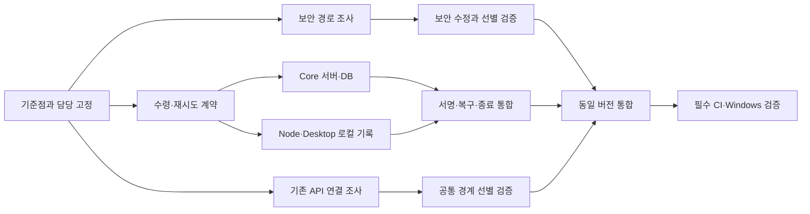

# SPS Core 선행 의존성과 병렬 작업 계획 — 2026-10-29

이 문서는 Builder 설계 적용 전에 필요한 Core 작업을 분리하기 위한 준비 기록이다. 실제 소스·잠금 파일·기존 실행 로그와 설계서를 비교했다. 제품 코드 변경, 의존성 설치·업그레이드, 테스트·audit·CI 실행은 하지 않았다. Core 개발 재개 지시로 확대하지 않는다.

관련 기준점과 검증 결과는 [실행 전 체크포인트](CHECKPOINT_PRESTART_2026-10-29.md), 기존 검토는 [Core 선행사항](CORE_PREREQUISITES_2026-10-29.md)을 참조한다. 원본 설계 파일은 수정하지 않는다.

## 1. 의존성의 두 종류

- **패키지 의존성:** 런타임·SDK·UI·DB·서명 라이브러리, 설치 관리자와 잠금 파일의 관계다.
- **작업 의존성:** 어떤 규약을 먼저 정해야 다른 담당자가 안전하게 구현·검증할 수 있는지의 관계다.

보안 수정이 끝나야 복구 규약 조사를 시작할 수 있는 것은 아니다. 반대로 서버와 클라이언트가 서로 다른 수령 재시도 규약을 먼저 구현하면 통합 비용과 중복 실행 위험이 생긴다.

## 2. 현재 패키지·실행 기반

아래 버전은 저장소에서 확인한 기준이며 최신 공개 버전의 추천 목록이 아니다. 새 패키지 설치나 전체 의존성 재해석을 하지 않았다.

| 구성 | 현재 확인된 기준 | 선행·병렬 작업에 미치는 영향 |
| --- | --- | --- |
| SPS Core | `pnpm@11.9.0`, `pnpm-lock.yaml`, `pnpm-workspace.yaml`; manifest Node `>=20`, Source CI Node 22 | 현재 지원 조합의 실무 기준은 CI와 SDK에 맞는 Node 22. 잠금 파일·patch 설정은 한 명만 통합 |
| SPS Plugin SDK | `@sonparkserver/plugin-sdk@0.11.0`, Node `>=22`; 독립 npm 잠금 파일 | 미출시 로컬 커밋 기준. 패키지 버전 문자열만 같아도 같은 구현이라고 보지 않기 |
| Desktop | `0.4.137`, Electron 앱, `package-lock.json`; SDK 및 desktop-node를 `file:`로 참조 | 로컬 참조·동기화·Core 패키징이 선행. 다른 담당자가 설치·동기화하는 동안 같은 산출물을 검증하지 않기 |
| Core UI | React/React DOM manifest `^19.2.7` | Builder는 Host React bridge를 우선 사용. 별도 React 중복 번들·ABI 호환은 실제 연결 확인 필요 |
| Core 내부 plugin SDK | Core workspace의 `@paperclipai/plugin-sdk@1.0.0`, `packages/plugins/sdk` 빌드 | 외부 공개 `@sonparkserver/plugin-sdk`와 이름·빌드 경로가 다름. 서로를 대신 빌드했다고 간주하지 않기 |
| Core DB | 기존 schema·Drizzle migration 체계; 현재 완료 보고 변경은 `0175`까지 | 다음 번호·snapshot·journal은 조사 시점 번호로 미리 확정하지 말고 통합 직전 재확인 |
| Builder 새 저장소 | 설계·검토 문서와 HTML 시제품만 있음 | 아직 설치된 제품 의존성이나 package manifest가 없음. 설계 후보를 현재 설치 패키지로 보고하지 않기 |

근거 경로는 Source checkout 기준: `external/sps-core/package.json`, `external/sps-core/pnpm-workspace.yaml`, `external/sps-plugin-sdk/package.json`, `external/sps-core/ui/package.json`, `sps-server/desktop/package.json`, `.github/workflows/sps-verify.yml`.

## 3. 반드시 먼저 확정할 경계

### G0 — 기준 버전과 파일 담당

Source·Core·SDK의 실제 커밋, 작업 트리 상태, 마지막 원격 CI를 먼저 고정한다. 다른 담당자의 수정·설치를 섞은 상태로 수행한 검사 결과는 최종 버전의 증거로 쓰지 않는다. Core/SDK 하위 저장소 커밋과 Source의 gitlink·지원표가 일치해야 한다.

### G1 — 보안 수정 방식

Core는 Zod 3 사용 경로와 Zod 4 경로를 함께 보유한다. 이미 `zod@3.25.76` 로컬 patch와 `zod@^4.0.0`에 대한 `4.6.6` override가 있다. 따라서 무조건 전부 v4로 올리는 것을 작업 시작점으로 삼지 않는다.

기존 production audit는 높은 등급의 Zod advisory로 실패했다. 패치가 실제 위험을 줄이는지와 버전 기반 audit가 해소되는지는 다른 질문이다. 적용 경로·호환성·악성 입력에 대한 보완 효과·검사 판정을 확인한 뒤 수정 방식을 정한다. 보안 policy의 차단 등급을 낮추거나 예외를 임의 추가하지 않는다.

객관적으로 확인한 경로와 공백:

- Core `server`, `packages/shared`, `packages/plugins/sdk`, `packages/mcp-server`, `cli`는 `zod: ^3.24.2`를 직접 선언하며 lock은 patched `3.25.76`으로 해석한다. v4 override는 이 v3 직접 의존성을 자동 교체하지 않는다.
- Core 내부 SDK는 `z`를 다시 export하므로 v4 전환은 SDK·shared validator 소비자의 호환성에도 영향을 준다. 오류 API·issue 형식 등에 변경이 있다. [Zod 공식 마이그레이션 안내](https://zod.dev/v4/changelog)
- 공식 advisory는 영향 범위를 `<4.6.6`, 수정 버전을 `4.6.6`으로 표시한다. 이것만으로 4.6.6의 v3 호환 진입점까지 현재 로컬 패치와 같은 보완을 받는다고 추론하지 않는다. [GHSA-mrhx-c7xc-m3w5](https://github.com/advisories/GHSA-mrhx-c7xc-m3w5)
- 현재 patch 파일 hash `82d58282…`는 lock과 일치한다. 하지만 기존 `work/zod-installed-final.log`는 `98ab5563…`를 기록하므로 현재와 동일한 설치 산출물의 검증 근거가 아니다. 설치·배포본에서 실제 사용하는 patch를 고정한 뒤에만 선별 검증을 다시 수행한다.
- 기존 Core 문서 `doc/SPS-ZOD-V3-ISSUE-BUDGET.md`는 현재 패치가 완전한 advisory 해결이 아니며 Map·상한 없는 입력 등에 한계가 있다고 명시한다. 개별 입력 경로의 도달성과 현재 배포 산출물은 이번에 실행 검증하지 않았다.
- 기존 요약 audit 로그만으로 모든 전이 의존 경로를 복원할 수는 없다. 직접 소비자 확인과 전체 해석 경로 확인을 같은 완료 항목으로 취급하지 않는다.

### G2 — 원격 작업 수령·재시도 규약

서버와 클라이언트 구현을 나누기 전에 다음을 한 계약으로 정한다.

- 요청 정체성과 Workspace·Node·작업 종류의 결합 범위
- 동일 요청의 동일 결과 재조회, 작업이 없는 HTTP 204 결과의 재조회
- 서버의 수령 상태 변경과 영속 receipt 저장의 원자성
- 서명에 포함할 필드와 재시도 시 새 nonce 사용 등 기존 재전송 방어와의 호환
- 권한 철회·Workspace 중지·만료·작업 상태 변경 이후 재조회에서 허용할 범위
- 로컬 수령 요청 기록과 실행 진입 기록을 언제 안전하게 저장할지
- 실행 여부를 모르는 작업은 자동 재실행하지 않는 규칙
- 기존 클라이언트·기존 행의 동작과 단계적 도입·롤백 범위
- receipt 보존 기간과 로컬 미결 기록의 수명, 만료·삭제 이후 불확실한 요청의 처리

`claimRequestId` 등의 이름과 저장 구조는 설계 후보이며 이번 요청에서 API를 확정·구현하지 않았다. 기존 완료 보고 outbox만으로 수령 단계의 유실 복구가 해결됐다고 보지 않는다.

서버 receipt와 로컬 기록을 추가해도 “실행 진입을 기록한 직후 실제 프로세스를 띄우기 전에 종료”와 같은 불확실 구간은 따로 다뤄야 한다. 이를 무조건 재실행하거나 정확히 한 번 실행이 보장된다고 표현하지 않는다. 안전한 미확인 상태와 수동 복구 한계도 계약에 포함한다.

현재 호출 경로는 다음과 같다.

| 경계 | 실제 파일·대략적 시작 라인 | 확인된 사실 |
| --- | --- | --- |
| Core Agent/Plugin claim | `external/sps-core/server/src/services/sps-node-operations.ts:470`, `:599` | queued→claimed CAS. 요청별 receipt는 없음 |
| Route·공유 검증기 | `external/sps-core/server/src/routes/sps-nodes.ts:1323`, `packages/shared/src/validators/sps-nodes.ts:126` | 기존 서명·권한 경계와 요청 호환을 같이 유지해야 함 |
| Node 서명 요청 | `sps-server/desktop-node/src/hub-client.mjs:241`, `src/protocol.mjs:7` | 현재 `{}` 요청. nonce는 단회 재전송 방어용이며 안정 요청 ID로 재사용하지 않음 |
| 작업 선택·실행 진입 | `sps-server/desktop/src/node-command-poller.mjs:38`, `src/main.mjs:5530` | Agent 우선, 없으면 Plugin. 수령/실행 시도 표시는 메모리 중심 |
| 완료 outbox | `sps-server/desktop/src/node-completion-outbox.mjs`, `src/state.mjs` | 암호화된 최종 완료 보고 보존. claim 저널은 아님 |

### G3 — Builder와 Host의 실제 연결 규약

- 공개 SPS SDK `@sonparkserver/plugin-sdk`와 Core 내부 `@paperclipai/plugin-sdk`의 manifest·worker·UI ABI를 먼저 매핑한다. 동일 SDK라고 가정하지 않는다.
- Core Workspace 경계, 소스 실행용 project workspace의 primary, Workspace Shell provider 선택, Git worktree를 구분한다. `primary`라는 이름만으로 기본 UI Shell이 선택되는 것은 아니다.
- 외부 SPS SDK `manifest/index.mjs:199-208`은 Workspace config의 `secret-ref` 필드를 현재 거부한다. 기존 Host secret broker·권한을 통해 필요한 계정 참조를 제공할 수 있는지 확인하고, 일반 JSON에 토큰을 추가해 우회하지 않는다. 공통 비밀 API 확장이 필요한지는 아직 확정하지 않았다.
- Core Codex adapter `execute.ts`에는 ACP 선택 분기와 exec 실행 경로가 모두 있다. 어느 경로가 선택되는지와 제품 요구의 이력·승인·재개 지원을 별도로 확인한다. 기존 adapter가 있다는 이유로 v15의 직접 SDK/app-server UI 세션이 이미 구현됐다고 보지 않는다.

G3 확인 전에도 Builder의 자체 데이터 타입·샘플 기반 화면·상담 자료 parser 설계는 독립적으로 진행할 수 있다. 실제 Builder 구현은 이번 요청에 포함되지 않으며, 위 조직·화면 기능이 Core 완료의 새 선행조건은 아니다.

## 4. 작업 단위와 선행 관계

| ID | 작업 | 먼저 필요한 것 | 병렬 가능 범위 | 완료 근거 |
| --- | --- | --- | --- | --- |
| P0 | 기준점·기존 증거·파일 담당 기록 | 없음 | 이번 조사에서 완료 | 체크포인트의 커밋·해시·상태 |
| A1 | 보안 의존 경로·보완 방식 결정 | P0 | B1·C1과 병렬 조사 | 경로·후보·호환 위험과 검증 항목 |
| A2 | 선택한 보안 수정과 선별 검증 | A1, 실제 개발 재개 | B2·B3과 파일 분리 시 병렬 | 영향 범위 검사 및 기존 보안 gate |
| B1 | 수령·재시도·실행 진입 계약 | P0 | A1·C1과 병렬 조사 | G2 항목 및 호환·실패 상태 확정 |
| B2 | Core DB·receipt·서비스·route 구현 | B1, 실제 개발 재개 | B3과 계약 고정 뒤 병렬 | 200/204 재조회·경합·권한 검사 |
| B3 | Node/Desktop 로컬 기록·재연결 구현 | B1, 실제 개발 재개 | B2와 계약 고정 뒤 병렬 | 저장 실패·재시작·실행 경계 검사 |
| B4 | 서명·상태·종료/완료 보고 통합 | B2+B3 | A2의 독립 수정과 병렬 가능 | 중복 실행 방지 및 기존 종료 증거 회귀 검사 |
| C1 | Workspace·Shell·Secret·세션 계약 매핑 | P0 | A1·B1과 병렬 조사 | 기존 API와 미확인 항목 분리 |
| C2 | 필요한 공통 경계의 작은 연동 검증 | C1, 고정된 실행 기준 | 독립 DB·포트·프로필 사용 시 가능 | 두 Workspace 범위·중지·재시작 등의 관찰 결과 |
| I1 | Core/SDK/Source 버전 통합 | 채택한 A·B 수정의 선별 검증, 관련 공통 경계 확인 | root 단일 통합 | gitlink·지원표·생성 문서 일치 |
| I2 | 최종 조합의 필수 CI·Windows 검증 | I1 | CI 자체 job 병렬성 사용 | 해당 Source 커밋의 실제 결과 |

원격 작업 자동 복구의 완료를 주장하려면 B 경로가 필요하다. Builder의 기본 화면·문서·로컬 연결 조사까지 B 경로 완료를 기다릴 필요는 없다. C1에서 다루는 Builder 전용 전체 대화 UI나 조직 기능은 Core 출시의 새 필수 조건이 아니다.

## 5. 병렬 담당과 충돌 방지

총괄은 의존 관계·안전성·권한·복구 계약의 판단과 최종 통합을 담당한다. 최신 사용자 지침에 따라 GPT-6 Luna high에는 **높은 추론이 필요하지 않은 확인·정리·확정된 규약의 반복 연결**을 병렬 배분한다. 복잡한 claim 경합·거래 원자성·권한 철회·실행 진입 로직은 root가 맡는다. 이번 조사도 세 에이전트가 읽기 전용으로 파일·버전·호출·검사 경로를 확인하고 root가 결론을 검토했다.

| 담당 | 독립 담당 영역 | 동시에 수정하지 않을 영역 |
| --- | --- | --- |
| Luna A — 의존성 확인 | 버전·의존 경로·patch 포함 파일·소비자 목록·기존 검사 경로 | 보안 수정 방식과 예외 여부는 root 판단. 잠금 파일은 단일 작성자 |
| Luna B — Core 연결 보조 | root가 고정한 타입·필드의 반복 연결, export와 fixture·검사 사례 정리 | service의 transaction·권한·경합 및 migration 번호·snapshot·journal·공통 서명 타입은 root 담당 |
| Luna C — 실행 컴퓨터 연결 보조 | root 규약에 따른 순수 직렬화/파싱·오류 표시·fixture·문서 | `main.mjs`와 실행 진입·영속 저장·재시도 orchestration은 root 담당 |
| root — 설계·핵심 구현·통합 | 보안 방식, 재시도 계약, transaction·권한·실행 진입 로직, 공통 파일·검증 증거 | Source 지원표·생성 문서·하위 저장소 참조·최종 커밋은 단일 작성자 |

표의 병렬 가능성은 파일·계약의 의존 관계 기준이다. 복잡한 판단을 Luna에 넘기기 위한 이유로 사용하지 않는다. root가 처리해야 할 핵심 로직은 순차 진행하고, 그동안 독립적인 자료 확인·확정된 반복 연결·fixture 작업을 병렬화한다.

설치·빌드·테스트가 같은 `node_modules`, `dist`, embedded DB, 테스트 사용자 프로필을 공유하면 소스가 달라도 충돌할 수 있다. 별도 소유 환경이 없으면 순서대로 수행한다. 선별 검증은 입력이 고정된 상태에서 수행하며, 병렬 수정 중인 작업 트리의 통과 결과를 최종 근거로 재사용하지 않는다.

## 6. 최소 검증 원칙

이번 요청에서는 아래 검증을 실행하지 않았다. 개발 재개 후 변경 범위에 맞게 고르며, 실패·새 변경·미해결 우려가 없으면 반복하지 않는다.

| 변경 범위 | 먼저 확인할 경로 | 조건부 추가 확인 |
| --- | --- | --- |
| 보안 보완 | 실제 Zod 소비자·악성 입력 처리·보안 gate 관련 검사 | 영향을 받는 shared/server/UI 타입·번들, 최종 audit 판정 |
| Core receipt | 같은 요청 재조회, 204 기록, 동시 claim 경합, 서명·권한·Workspace 경계 | 새 migration의 실제 격리 DB 적용 및 기존 행 호환 |
| Node/Desktop 기록 | 저장 실패 시 실행 차단, 응답 유실·재시작, 실행 진입 후 중복 실행 방지 | 기존 완료 outbox·실행 중지·종료 확인 회귀 |
| 공통 플러그인 연결 | 두 Workspace의 데이터·권한·Shell 선택·실행 중지 | 관련 부분의 실제 Desktop 재시작·패키징 확인 |
| 버전 통합 | gitlink·support matrix·생성 문서·local file 참조 일치 | 최종 조합의 필수 Windows/CI |

재사용할 기존 선별 검사 파일은 Core의 `server/src/__tests__/sps-nodes-routes.test.ts`, `server/src/services/sps-node-closure-evidence.test.ts`, `server/src/__tests__/sps-workspace-execution-delete-guard.test.ts`, Zod의 `zod-v3-issue-budget`/`sps-validation-compatibility` 관련 파일, Source Desktop의 `test/node-command-poller.test.mjs`, `test/node-command-poller-main.test.mjs`, `test/node-completion-outbox.test.mjs`, `test/state.test.mjs`다. 파일이 존재한다는 사실과 새로운 복구 계약을 이미 검증한다는 주장은 구분한다. 새 계약의 실패 시나리오는 구현 후 필요한 범위만 추가한다.

전체 로컬 테스트·전체 audit·전체 빌드를 기본 준비 작업으로 실행하지 않는다. 기존 `sps-verify.yml`은 push/PR에서 full build·regression job도 자동 실행하므로, 나중에 Source를 push하면 선별 검사만 돈다고 약속하지 않는다. 필수 CI를 삭제하거나 차단을 무시하지 않고, 통합본으로 모아 검증하며 이유 없는 재실행을 피한다.

## 7. 현재 범위 밖과 조건부 확장

Builder의 Graph·Lead/CTO 조직·질문·승인·GitHub 연동은 Builder 소유다. 공유 기억의 변경은 Workspace별 단일 작성자로 먼저 검토하고, 현재 저장 계약으로 필요한 영속 정합성을 충족하지 못할 때만 Core 조건부 쓰기 기능을 검토한다.

설계의 React Flow·elkjs 등은 선택 후보이며 실제 Builder 설치 의존성이 아니다. 라이선스 차이는 허용받았으므로 차단 항목으로 되돌리지 않는다. Native 신규 개발, 공개 Marketplace, 완전한 비신뢰 코드 OS 격리, 자체 CI/Runner Fleet도 선행조건에 추가하지 않는다.
